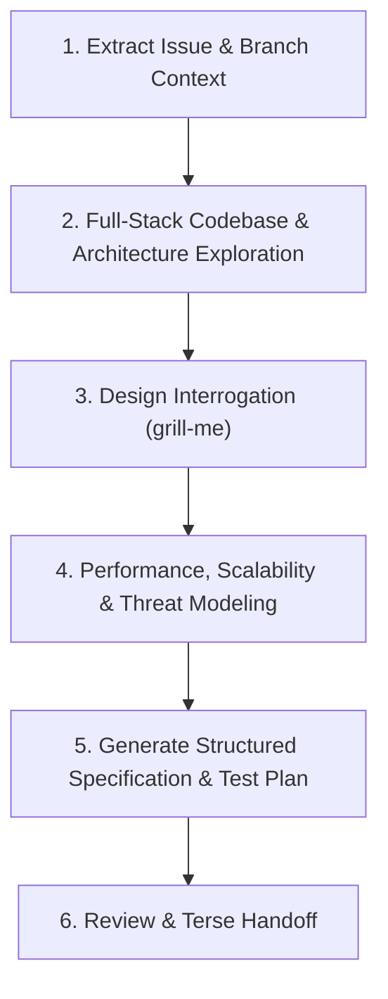

# Generate Feature Specification

## Overview

Convert high-level feature requests and GitHub issues into highly structured, architecture-compliant, secure, and performant technical specifications with comprehensive test plans in `docs/specs/spec-<branch_name>.md`.

---

## 6-Step Specification Generation Process



### 1. Determine Issue and Branch Context
- **Branch Context**: Run `git branch --show-current` to get the active branch.
- **Issue ID**: Extract the issue number from the branch prefix (e.g. `feat/92-reservation-changes` $\rightarrow$ `92`). If no active branch exists, ask the user or use the target issue number.
- **Fetch Details**: Retrieve the issue via GitHub CLI:
  ```bash
  gh issue view <issue_number> --json number,title,body,labels
  ```
  > *Note*: Use the GitHub issue strictly to *inform* intent. Never copy raw issue text verbatim into the spec.

### 2. Full-Stack Codebase & Architecture Exploration
- **Read System Architecture**: Inspect [`docs/ARCHITECTURE.md`](file:///home/pav/code/our_places_rs-update-agent-md/docs/ARCHITECTURE.md) and [`CONSTRAINTS.md`](file:///home/pav/code/our_places_rs-update-agent-md/CONSTRAINTS.md) to understand crate boundaries, database locking conventions, and tri-currency precision rules.
- **Trace Full Stack**: Never stop at the first file. Trace impacted components across all monorepo layers:
  - `common/`: Domain models, pricing math (`Decimal`), error variants, validation rules.
  - `db_core/`: Schema tables, migrations, SQLx entity queries, row-level locks.
  - `app_api/`: Actix-web route handlers, DTO validation, auth extractors (`Claims`).
  - `web_ui_guest` / `web_ui_admin` (+ `web_ui_common`, `web_client`): Topcoat SSR pages, HTMX endpoints, Topcoat UI components.
  - Background workers: `email_worker`, `image_worker`.
- Inspect existing specifications in `docs/specs/` for baseline formatting and depth.

### 3. Design Interrogation (`grill-me`)
- Before writing the specification, invoke the **[`grill-me`](../grill-me/SKILL.md)** skill to interrogate design decisions, edge cases, and requirements.
- Walk down each branch of the decision tree one question at a time.
- Resolve tradeoffs (e.g., locking strategies, cache invalidation, fallback UX, rate limiting) until reaching $\ge 95\%$ confidence.

### 4. Performance, Scalability & Threat Modeling Reviews
Conduct explicit engineering reviews across two mandatory dimensions:
1. **Performance & Scalability Check**:
   - Check for Big-O inefficiencies, N+1 query patterns, and memory allocations.
   - Enforce GCP Cloud Run scale-to-zero budget ($< 300\text{ms}$ p50 cold starts, $256\text{MB}$ RAM).
   - Ensure async handlers never block worker threads (use `tokio::task::spawn_blocking` for CPU-heavy tasks like password hashing).
2. **Threat Modeling & Security Review (OWASP Top 10)**:
   - Identify trust boundaries (HTTP inputs, URL queries, file uploads, third-party webhooks).
   - Check IDOR protections: verify user owns the target entity ID on every access.
   - Parameterize all SQLx queries (zero raw string concatenation).
   - Verify JWT and session validation bounds on protected endpoints.

### 5. Generate Structured Specification
Write the final document to `docs/specs/spec-<branch_name>.md` using this standardized schema:

```markdown
# Spec <Issue Number>: <Title>

## Overview
High-level summary of the feature, business value, and target user personas.

## Requirements
- **Functional Requirements**: Clear, numbered requirements and user journeys.
- **Exclusions / Non-Goals**: Explicit out-of-scope boundaries.

## Edge Cases & Failure States
Explicit boundary conditions, concurrent race windows, network drops, and hold timeouts.

## Technical Implementation
- **Data Models & Schema**: Database tables, migrations, SQLx queries, domain structs in `common/`.
- **API Endpoints**: Request/Response contracts, route paths, HTTP status codes, error payloads.
- **Frontend Views**: Topcoat SSR pages, HTMX swap targets, DaisyUI components.
- **Background Workers**: Outbox tasks, email dispatch, Pub/Sub events (if applicable).

## Performance Considerations
Big-O complexity, database query indexing, memory constraints, and Cloud Run latency budgets.

## Security Mitigations
OWASP Top 10 safeguards, trust boundary validation, IDOR checks, and secret isolation.

## Test Plan
- **Unit Tests**: Domain math, pricing rules, validation functions (`cargo test -p common`).
- **Integration Tests**: API handlers, DB transactions, row-level locks (`cargo test -p <api>`).
- **E2E Tests**: Playwright browser flows covering guest and admin portals.

## Acceptance Criteria
- [ ] Numbered, verifiable completion checklist.
```

### 6. Review & Terse Handoff
- Save the file to `docs/specs/spec-<branch_name>.md`.
- Output only the clickable file link and a compact list of open questions or next steps. **DO NOT dump or re-summarize the full spec content in chat.**
