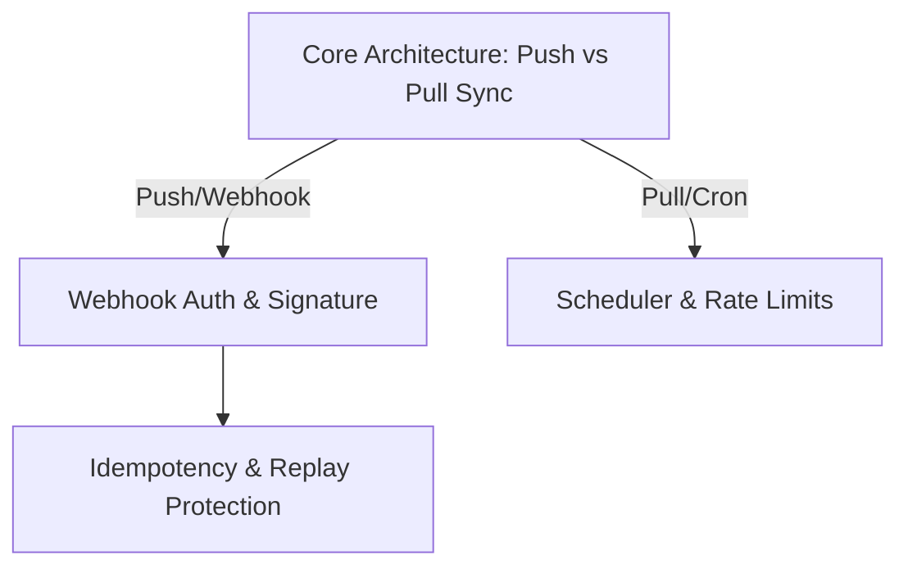

# Grill Me / Interview Me

## Overview

What users ask for and what they actually need are frequently different things. They might ask for "a dashboard" because that's conventional, when they actually need a simple list or an alert. They may say "make it faster" without a target metric, or request a complex architecture when a thin vertical slice suffices.

Furthermore, long coding sessions accumulate unstated assumptions that turn into bugs or rework. The cheapest moment to close this gap is before any plan, spec, or code exists.

This skill is the interactive interrogation gate: you ask **one question at a time**, with your **best guess and recommendation attached**, systematically walking down each branch of the decision tree until you reach **$\ge 95\%$ confidence** about underlying intent and constraints.

---

## The Iron Rules

1. **Codebase Exploration First (Zero Lazy Questions)**:
   - If a question can be answered by exploring the codebase, reading schemas, checking configuration files, or viewing existing implementations, **explore the codebase instead of asking**.
   - Never ask the user: *"What does the current database schema look like?"*, *"Which authentication method is used?"*, or *"Where are routes defined?"*. Find out yourself first.
2. **One Question at a Time**:
   - Ask exactly one focused question per turn. Never batch multiple questions into a survey.
3. **Always Attach a Guess / Recommendation**:
   - Every question must include your hypothesis (`GUESS:`) grounded in codebase conventions and engineering trade-offs. The user reacts faster to a concrete (or wrong) recommendation than an open-ended survey.
4. **Resolve Decision Trees Branch-by-Branch**:
   - Walk down each branch of the design tree hierarchically. Resolve root architectural decisions (e.g., storage model, sync vs async) before asking about dependent leaf details (e.g., UI component styling).
5. **No Hallucinated Intent**:
   - Probe for *"what you actually want vs. what you think you should want"*. Pierce buzzwords ("scalable", "clean architecture") to find concrete requirements.

---

## When to Use

- The request is underspecified (missing: who it's for, why now, success metrics, binding constraints).
- Before drafting a spec (`generate-spec` / `spec-driven-development`) or planning an architecture.
- The user explicitly invokes `/grill-me`, `/interview-me`, "grill me", "interview me", "stress-test my thinking", or "are we sure?".
- You catch yourself silently making non-trivial assumptions about business rules, UX flows, or domain invariants.

### When NOT to Use
- Mechanical or self-contained tasks ("fix typo", "rename variable", "run linter").
- The user explicitly asks for speed over verification.
- Pure informational queries ("how does the auth middleware work?", "what does this function return?").
- You already have $\ge 95\%$ confidence (can predict user's reactions to the next 3 decisions).

---

## Loading Constraints

This skill requires an interactive user. **Do not run in non-interactive/autonomous loops** (CI, `/loop`, headless pipelines). If an ask is underspecified in an autonomous loop, stop and flag the missing requirement rather than guessing.

---

## The Process

### Step 1: Hypothesize Intent & State Confidence
Before asking the first question, write down your current best read of the user's intent in **one sentence**, plus an honest confidence rating ($0\text{--}100\%$):

```markdown
HYPOTHESIS: You want to expose a webhook for third-party calendar sync, but "calendar integration" was the high-level phrase used.
CONFIDENCE: ~30% — missing: directionality (import vs export vs two-way), conflict resolution strategy, and iCal vs provider API.
```

*Rule*: If confidence is $< 70\%$, you must append a one-line explanation of what is still missing.

### Step 2: Codebase Pre-Check
Before formulating the question, run quick tool checks (`grep_search`, `view_file`):
- Does this domain already have an entity, migration, or endpoint?
- Do project guidelines (e.g., `GEMINI.md`, `AGENTS.md`, `CLAUDE.md`) or existing code impose architectural constraints, performance budgets, or strict domain types?

Incorporate what you discover into your guess:
```markdown
Q: Should the sync job run asynchronously in a background worker or synchronously within the HTTP request lifecycle?
GUESS: Asynchronous background worker. Codebase checks show the API endpoints enforce a strict response latency budget, and synchronous external HTTP calls risk timing out during third-party rate limits.
```

### Step 3: Ask One Question with Attached Guess
Format:
```markdown
Q: <one focused question targeting the next branch in the decision tree>
GUESS: <your recommended answer with clear technical reasoning>
```

Wait for the user's answer before asking the next question.

### Step 4: Probe "Want vs. Should Want"
Watch out for answers that recite convention or sophistication-signaling buzzwords ("industry standard", "fully scalable", "microservices").
When you hear these, challenge the assumption:
> *"If you didn't have to justify this to anyone or follow standard conventions, what would you actually want to happen here?"*

### Step 5: Decision Tree Branching
Track dependencies between decisions:

Do not ask about `Idempotency & Replay Protection` until `Push vs Pull Sync` is settled.

### Step 6: Restate Intent & Scope Boundaries
When confidence reaches $\ge 95\%$, produce a crisp, structured statement of intent:

```markdown
### Statement of Intent

- **Outcome**: <one line — what is delivered>
- **User**: <one line — who benefits>
- **Why Now**: <one line — trigger or failure mode being resolved>
- **Success Criteria**: <measurable test or metric>
- **Binding Constraint**: <technical, performance, or domain invariant, e.g., memory ceiling, strict decimal precision, SLA>
- **Explicitly Out of Scope**: <what is deliberately NOT being built right now>

Yes / no / refine?
```
> **Non-negotiable**: "Explicitly Out of Scope" must be included. Silent disagreement over non-goals is the #1 cause of scope creep.

### Step 7: Confirmation Gate & Clean Turn Stop
The user must give an explicit confirmation ("yes", "approved").
- "Sounds good", "whatever you think", or silence are **NOT** approvals. If received, ask: *"Is there anything you would refine, or do you want to lock this down?"*
- Once confirmed:
  1. Record or offer to save intent to `docs/intent/intent-<slug>.md` (or hand off to `generate-spec`).
  2. **STOP YOUR TURN IMMEDIATELY**. Do not start writing code or running tools in the same turn without explicit direction.

---

## Anti-Rationalization Table

| Rationalization | Reality |
| :--- | :--- |
| *"The ask is obvious enough, I can skip grilling."* | If you cannot state the outcome, constraints, and non-goals in one sentence, you have a vibe, not a spec. |
| *"I'll just ask the user what the current table schema is."* | Lazy. Explore the codebase yourself (schema, migrations, or types). User time is for intent, not code grep. |
| *"I'll batch 5 questions so we finish faster."* | Batching causes skimmed answers and locks in wrong assumptions before the first branch is resolved. |
| *"If I give my guess, I might bias the user."* | The user reacts 3x faster to a concrete hypothesis than a blank canvas. Be visibly willing to be wrong. |
| *"They said 'whatever you think is best', so I'll proceed."* | Delegation is not consensus. Present two concrete trade-offs and ask them to choose. |
| *"I'll jump straight into generating the spec and code now."* | Stop rule: Confirm intent first, then hand off cleanly to `generate-spec` or `draft-intent`. |

---

## Verification Checklist

- [ ] Explored the codebase first to verify facts before asking questions
- [ ] Stated an initial hypothesis with an explicit confidence percentage ($0\text{--}100\%$)
- [ ] Explained missing factors whenever confidence was $< 70\%$
- [ ] Asked exactly one question per turn, each with a clear recommendation/`GUESS:` attached
- [ ] Resolved architectural decision branches sequentially before asking leaf questions
- [ ] Tested for "want vs. should want" when buzzwords or generic conventions were invoked
- [ ] Formatted the final intent with all 6 fields (Outcome, User, Why Now, Success, Constraints, Out of Scope)
- [ ] Received explicit confirmation before ending the interview
- [ ] Stopped the turn cleanly upon confirmation without jumping into unapproved execution
