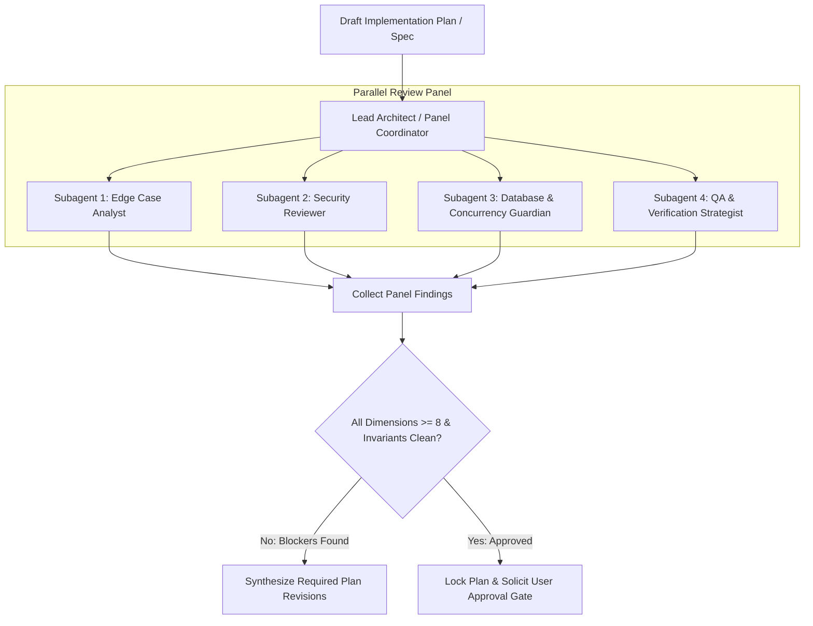

# /plan-eng-review — Multi-Agent Engineering Plan Review Panel

## Goal
Lock feature implementation plans through an adversarial, multi-agent review panel. By distributing plan interrogation across specialized subagents with isolated context windows, the panel eliminates single-agent confirmation bias and verifies architecture, security, concurrency, and testability before any code is written.

## When to Use
Run `/plan-eng-review` when:
- A technical specification (`docs/specs/spec-*.md` or `SPEC.md`) or implementation plan (`tasks/plan.md`) has been drafted.
- A proposed change touches core domain crates (`common/`, `db_core/`), critical API flows (`booking_api/`, `listing_api/`), or data schemas.
- You need engineering sign-off to transition from **Stage 1 (Plan & Design)** to **Stage 2 (Build)**.

---

## Panel Architecture & Roles



### Reviewer Roles & Scope

| Role | Agent Persona / Skill Reference | Audit Focus |
| :--- | :--- | :--- |
| **Lead Architect** *(Panel Coordinator)* | Orchestrator | Base branch detection, component boundaries, data flow diagrams, monadic pipelines, scale-to-zero budget (<300ms p50). |
| **Edge Case Analyst** | [`.agents/agents/edge-case-analyst/AGENT.md`](file:///home/pav/code/our_places_rs-feat-92-feat-reservation-changes/.agents/agents/edge-case-analyst/AGENT.md) | Empty/null states, boundary inputs, 1000x scale behavior, network partition handling, malformed payloads. |
| **Security Reviewer** | [`.agents/agents/security-reviewer/AGENT.md`](file:///home/pav/code/our_places_rs-feat-92-feat-reservation-changes/.agents/agents/security-reviewer/AGENT.md) | Authn/authz gaps, Actix extractors (`Claims`), GCS signed URL expiry bounds, secret leakage, OWASP Top 10 vulnerabilities. |
| **Database & Concurrency Guardian** | [`.agents/agents/database-migration-guardian/AGENT.md`](file:///home/pav/code/our_places_rs-feat-92-feat-reservation-changes/.agents/agents/database-migration-guardian/AGENT.md) | PostgreSQL row-level locks (`SELECT ... FOR UPDATE`), transaction isolation, migration immutability, offline SQLx query safety. |
| **QA & Verification Strategist** | QA Lead | Test matrix completeness (Unit, Integration, E2E), error path coverage, invariant assertions, mock vs real DB isolation. |

---

## Multi-Agent Review Protocol

### Step 0: Baseline & Context Ingestion (Lead Architect)
1. Detect base branch:
   ```bash
   gh pr view --json baseRefName -q .baseRefName 2>/dev/null || \
   gh repo view --json defaultBranchRef -q .defaultBranchRef.name 2>/dev/null || \
   echo "main"
   ```
2. Read target plan (`tasks/plan.md`, `docs/plans/`, or `docs/specs/`), `ARCHITECTURE.md`, and [CONSTRAINTS.md](file:///home/pav/code/our_places_rs-feat-92-feat-reservation-changes/CONSTRAINTS.md).
3. Identify affected crates, API endpoints, database entities, and external dependencies.

---

### Step 1: Parallel Subagent Dispatch

The Lead Architect dispatches 4 specialized subagents. Each subagent runs independently in its own context window to avoid context contamination.

#### Dispatch Prompt: Subagent 1 — Edge Case Analyst
```
You are the Edge Case Analyst for the Our Places platform.
Review the implementation plan for:
1. Null, empty, and boundary inputs across all proposed DTOs and endpoints.
2. Concurrency hazards: race conditions, out-of-order requests, and duplicate submissions.
3. Network and infrastructure disruptions: timeouts, cold starts, and database connection pool exhaustion.
4. Scale stress: behavior under 1000x normal load.

Evaluate against CONSTRAINTS.md. Output your evaluation using the Standard Panelist Report schema.
```

#### Dispatch Prompt: Subagent 2 — Security Reviewer
```
You are the Security Reviewer for the Our Places platform.
Review the implementation plan for:
1. Authentication & authorization: verify Actix route extractors (web::ReqData<Claims>) and shadow user promotion.
2. Cloud Storage security: enforce GCP V4 signed URL boundaries and direct upload constraints (no raw streaming).
3. Secret isolation: verify no API keys, credentials, or JWT secrets are hardcoded or committed.
4. Input sanitization & injection defense (SQLx compile-time queries, Topcoat template escaping).

Evaluate against CONSTRAINTS.md. Output your evaluation using the Standard Panelist Report schema.
```

#### Dispatch Prompt: Subagent 3 — Database & Concurrency Guardian
```
You are the Database & Concurrency Guardian for the Our Places platform.
Review the implementation plan for:
1. Row-level database locking: ensure availability checks acquire strict `SELECT ... FOR UPDATE` locks.
2. Reservation hold lifecycle: enforce 15-minute hold TTL (`expires_at`) and immutable history in `booking_status_history`.
3. Financial precision: verify zero floating-point arithmetic (`f32`/`f64`) and strict `rust_decimal::Decimal` usage.
4. Database migrations: verify schema changes are non-destructive and existing migration files remain untouched.

Evaluate against CONSTRAINTS.md. Output your evaluation using the Standard Panelist Report schema.
```

#### Dispatch Prompt: Subagent 4 — QA & Verification Strategist
```
You are the QA & Verification Strategist for the Our Places platform.
Review the implementation plan for:
1. Test coverage plan: ensure every new code path has corresponding unit or integration tests.
2. Test categorization: verify P0 happy path, P0 empty/invalid input, P1 error handling, and P1 concurrency tests.
3. Test isolation: ensure unit tests in common/ run without DB dependencies, while DB tests run in isolated transactions.
4. Sanity check integration: confirm alignment with `sanity-check-workflow.md`.

Evaluate against CONSTRAINTS.md. Output your evaluation using the Standard Panelist Report schema.
```

---

### Step 2: Standard Panelist Report Schema

Every subagent must return its findings adhering to this structured format:

```markdown
### [Role Name] Review Findings
- **Dimension Score (0–10)**: <Score>
- **Hard Invariant Compliance**: [PASS | FAIL]
- **Blocking Deficiencies (Score < 8)**:
  - [ ] Description of blocker and required plan modification
- **Non-Blocking Observations**:
  - Observation or recommended optimization
```

---

### Step 3: Deliberation & Synthesis (Lead Architect)

The Lead Architect aggregates panel reports, resolves conflicting recommendations, and constructs the unified **Engineering Review Scorecard**:

| Dimension | Reviewer | Score (0–10) | Status | Key Blocker / Recommendation |
| :--- | :--- | :---: | :---: | :--- |
| **Architecture & Flow** | Lead Architect | 9/10 | Pass | Clean monadic pipeline; boundaries well defined |
| **Edge Cases & Scale** | Edge Case Analyst | 8/10 | Pass | Handled empty payload and connection drop |
| **Security Posture** | Security Reviewer | 9/10 | Pass | Claims extracted; V4 signed URLs enforced |
| **Data & Concurrency** | DB Guardian | 10/10 | Pass | Row-level locks and 15m hold TTL verified |
| **Test Matrix & QA** | QA Strategist | 8/10 | Pass | P0/P1 scenarios mapped to test files |

#### Gating Criteria
- **Pass Threshold**: Every dimension must score $\ge 8/10$.
- **Zero-Tolerance Invariants**: 100% compliance with [CONSTRAINTS.md](file:///home/pav/code/our_places_rs-feat-92-feat-reservation-changes/CONSTRAINTS.md) (no unwrap, no floats in money, row-level locks, doc comments).
- **If any score $< 8$ or invariant fails**: Mark the plan **UNLOCKED — REVISIONS REQUIRED**. Provide exact bulleted edits required in `tasks/plan.md`. Re-run subagent audit on the revised section.

---

### Step 4: Plan Lock & Approval Checkpoint

Once all dimensions pass:
1. Update the implementation plan header with:
   ```markdown
   > **Engineering Review Status**: LOCKED
   > **Review Date**: YYYY-MM-DD
   > **Review Panel**: Lead Architect, Edge Case Analyst, Security Reviewer, DB Guardian, QA Strategist
   ```
2. Prompt user for final execution checkpoint:
   > *"The Multi-Agent Review Panel has locked the engineering plan with an average score of [X]/10. Reply 'proceed' to begin implementation under `/build`."*
