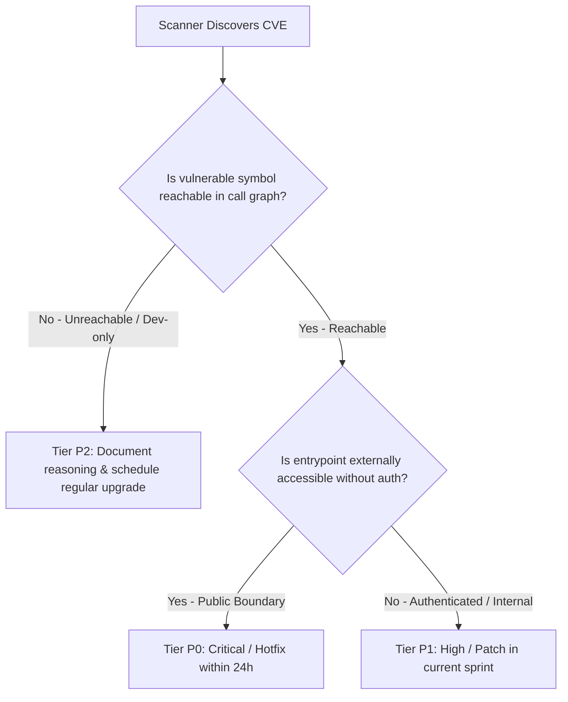

# Security and Hardening Reference & Checklists

## 1. OWASP Top 10 Evaluation Rubric

| Category | Primary Threat | Verification & Hardening Checks |
| :--- | :--- | :--- |
| **A01: Broken Access Control** | IDOR, missing role checks, path traversal | Ensure every protected endpoint verifies that the caller owns or has rights to the specific entity ID being accessed. Deny access by default. |
| **A02: Cryptographic Failures** | Plaintext transmission, weak algorithms, exposed keys | Enforce TLS 1.3/1.2; hash passwords using Argon2id or bcrypt ($\ge 12$ cost); ensure secrets are retrieved only via environment variables. |
| **A03: Injection** | SQL, NoSQL, OS command, LDAP injection | Use parameterized queries or compile-time verified queries exclusively. Reject dynamic string concatenation in queries and shell invocations. |
| **A04: Insecure Design** | Missing rate limits, business logic flaws, replay attacks | Write abuse cases; enforce rate limits on authentication attempts; verify availability holds expire cleanly; enforce idempotency on state transitions. |
| **A05: Security Misconfiguration** | Default credentials, permissive CORS, exposed stack traces | Disable debug endpoints in release builds; restrict CORS origins explicitly; configure security headers (`Content-Security-Policy`, `HSTS`, `X-Content-Type-Options`). |
| **A06: Vulnerable Components** | Outdated libraries with known CVEs | Run native package audits (`cargo audit`, `npm audit`) on the committed lockfile before releases; verify reachability of flagged symbols. |
| **A07: Identification & Auth** | Credential stuffing, weak sessions, missing lockout | Enforce adaptive brute-force throttling; validate JWT signature, issuer, and expiration; invalidate sessions on logout and password reset. |
| **A08: Software & Data Integrity** | Insecure deserialization, untrusted CI plugins | Validate digital signatures on artifacts; verify external signed URLs enforce strict expiration time-to-live and restricted HTTP verbs. |
| **A09: Logging & Monitoring** | Missing audit trails, logging credentials/PII | Log all security-relevant state changes (login, logout, permission changes, payment transitions); redact passwords, bearer tokens, and credit card numbers from logs. |
| **A10: SSRF** | Attacker probes cloud metadata or internal microservices | Allowlist external URL schemes (`https` only) and domains; resolve DNS and block connections to private, link-local, loopback, or cloud metadata IP ranges (`169.254.169.254`). |

---

## 2. Vulnerability Reachability & CVSS Triage Protocol



### SLA Resolution Tiers

| Priority Tier | Description | SLA Requirement |
| :--- | :--- | :--- |
| **P0 (Critical / Public Reachable)** | Vulnerable code is directly invocable by unauthenticated or low-privilege network callers. | **24 hours**: Immediate patch, hotfix, or mitigating WAF / input filter. |
| **P1 (High / Authenticated Reachable)** | Vulnerable code path is reachable only behind authentication or requires high operational complexity. | **Current sprint**: Patch dependency, verify regression tests, and deploy. |
| **P2 (Medium / Low / Unreachable)** | Advisory affects build-time tooling, test dependencies, or unreachable execution branches. | **Next scheduled maintenance**: Update during routine dependency refresh. |

---

## 3. Pre-Commit Security Grep Checks

Run these checks against staged diffs before creating commits:

```bash
# 1. Check for common secret keywords in staged changes
git diff --cached | grep -iE "(password|secret_key|api_key|bearer |private_key|token)[[:space:]]*="

# 2. Check for unsafe unparameterized query formatting
git diff --cached | grep -iE "(format!|concat!|f\").*SELECT.*FROM"

# 3. Check for raw debug print statements
git diff --cached | grep -iE "(dbg!|println!|console\.log)"
```

---

## 4. Standard Security Finding Template

```markdown
### Security Finding: [Short Descriptive Title]
- **Severity**: Critical | High | Medium | Low
- **Category**: [e.g., A01: Broken Access Control | A03: Injection | A10: SSRF]
- **Location**: `path/to/file.ext:L123`
- **Impact**: [What an attacker can achieve — privilege escalation, data exfiltration, system takeover]
- **Vulnerability Explanation**: [Technical root cause of the flaw]
- **Remediation**:
```diff
- // Vulnerable pattern
+ // Safe, hardened pattern
```
```
