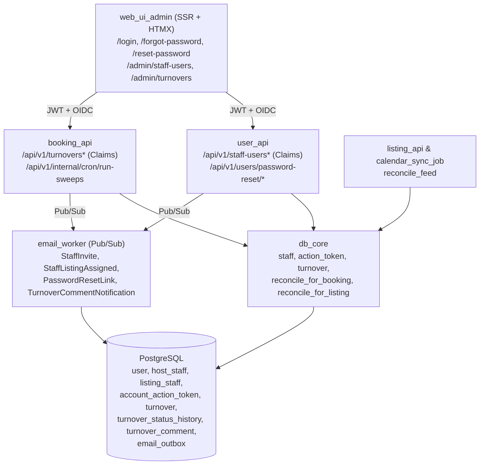
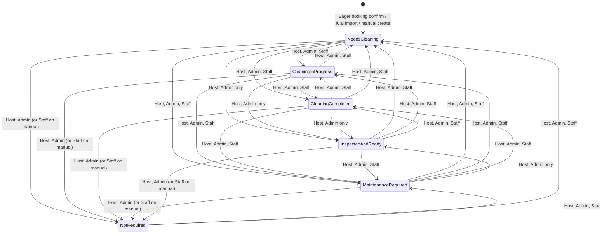

# Spec 66: Turnover & Cleaning Crew Dispatch View

*   **Author:** Pavel Byles
*   **Status:** Proposed
*   **Date:** 2026-11-18

--------------------------------------------------------------------------------

## Overview

Our Places manages short-term villa and apartment rentals in Jamaica through an isomorphic Rust monorepo (`common`, `db_core`, `app_api/*`, `web_client`, `web_ui_common`, `web_ui_admin`, `web_ui_guest`). This specification adds a mobile-friendly Turnover and Cleaning Crew Dispatch view inside `web_ui_admin` (`/admin/turnovers`) along with invite-only staff onboarding and listing assignment management at `/admin/staff-users`.

The feature enables three personas to coordinate villa readiness between guest stays:

*   **Hosts:** View turnovers across their own properties, invite and assign cleaning or maintenance staff at `/admin/staff-users`, create manual turnovers, update any turnover status (including signing off `Inspected & Ready`), and exchange per-turnover comments with staff.
*   **Administrators:** Retain platform-wide visibility and controls across all listings, staff assignments, and turnovers while keeping `/admin/users` strictly administrator-only.
*   **Cleaning & Maintenance Staff (`UserRole::Staff`):** Sign into `web_ui_admin` via an emailed set-password link (with self-service forgot-password recovery), view only the `/admin/turnovers` dispatch board for assigned listings without guest PII or financial figures, create manual turnovers when issues arise, transition non-inspection statuses (including unsetting `Inspected & Ready`), and post per-turnover comments.

## The Problem

Coordinating cleaning and maintenance between departing and arriving guests currently relies on off-platform communication and ad-hoc checks because the platform lacks turnover tracking and crew accounts:

1.  **No Crew Role or Guard Isolation:** PostgreSQL `user_role` and `common::models::UserRole` only define `Booker`, `Host`, and `Admin`. Both `web_ui_admin/src/support.rs` (`staff`) and `app_api/booking_api/src/apis/mod.rs` (`require_staff`) use the identifier `staff` to mean `Admin | Host` and protect revenue dashboards, bookings, guest PII, pricing, and payouts. Furthermore, `web_ui_common/src/shell_admin.rs` renders all privileged navigation links for any signed-in console user, and `web_ui_admin/src/pages/auth.rs` redirects `/login` directly to `/admin`.
2.  **Global User Directory Constraints & Multi-Host Cleaners:** `/admin/users` is locked to `admin_only` per Spec 96 (`A29–A31`) and `playwright/e2e/admin-portal/users-admin.spec.ts`. Opening `/admin/users` to hosts would expose role/archive controls and fail when two partner hosts hire the same cleaner because `"user".email` is globally unique.
3.  **No Unauthenticated Password-Setup or Reset Link Flow:** `app_api/user_api/src/apis/account.rs` (`request_password_change`) requires `current_password`, `registration::create_user` requires a caller-provided password and sends a 6-character email OTP, and neither `web_ui_admin` nor `web_ui_guest` has `/forgot-password` or `/reset-password` routes. Invited staff cannot set their own password or recover a forgotten password without a tokenized link flow.
4.  **No Turnover Record Across Bookings, External iCal Feeds, and Maintenance:** Turnovers must cover confirmed native bookings, external `ical_feed` blocks in `listing_blocked_dates` (where `db_core/src/calendar/reconcile.rs` hard-deletes disappeared feed events), and off-booking maintenance without altering listing calendar availability.

## Goals

*   **Role-Isolated Dispatch Access:** Introduce `UserRole::Staff` and `AdminRole::Staff`, rename existing `staff` / `require_staff` guards to `host_or_admin` / `require_host_or_admin`, and restrict `Staff`-only sessions in `web_ui_admin` strictly to `/admin/turnovers` with zero exposure of guest names, guest contact details, confirmation codes, booking door codes, rates, or payouts.
*   **Host-Scoped Staff Roster & Multi-Listing Assignment:** Add `/admin/staff-users` where hosts and administrators invite cleaning/maintenance staff by email and assign them to one or more owned listings (`host_staff` and `listing_staff` relationships), allowing one cleaner email to serve multiple hosts safely without modifying `/admin/users` access rules.
*   **Hashed Single-Use Invite & Password-Reset Flow:** Implement SHA-256 hashed, single-use, time-limited `account_action_token` links for staff invitation onboarding and `/forgot-password` / `/reset-password` recovery in `web_ui_admin` and `user_api`, revoking stale sessions on password change.
*   **Eager Dated Turnover Lifecycle:** Automatically create and update turnovers eagerly upon native booking confirmation/modification/cancellation and external `ical_feed` synchronization (`listing_blocked_dates` with `source = 'ical_feed'`), keyed by logical source with `ON DELETE SET NULL` foreign keys so feed deletions preserve turnover and comment history. Allow hosts, administrators, and staff to create manual turnovers (for manual calendar blocks or off-booking maintenance), while keeping `manual` calendar blocks non-auto-generating.
*   **Six-State Operational Workflow:** Track `Needs Cleaning`, `Cleaning In Progress`, `Cleaning Completed`, `Maintenance Required`, `Inspected & Ready`, and `Not Required` strictly as operational states that do not affect guest availability. Keep all status transitions manual (no automated transition to `Inspected & Ready`); allow hosts and administrators to transition between any statuses, and allow staff to transition into any status except `Inspected & Ready` while permitting staff to transition out of `Inspected & Ready`.
*   **Mobile-First Dispatch UI & Per-Turnover Email Threads:** Deliver a mobile-friendly Topcoat/HTMX dispatch interface with server-side filtering/pagination, immutable `turnover_status_history` auditing, isolated `turnover_comments` threads, and `email_outbox` email notifications on new comments and invites/resets.

## Non-Goals

*   Blocking or altering guest listing availability when a turnover enters `Maintenance Required` or any other operational status.
*   Automatically transitioning turnovers to `Inspected & Ready` based on check-in timestamps or cron jobs.
*   Auto-generating turnovers from `manual` rows in `listing_blocked_dates`.
*   Opening `/admin/users` to hosts or altering Spec 96 `A29–A31` admin-only user directory parity.
*   Crew payroll, cleaner invoicing, time-clock tracking, checklist photo uploads, or external SMS/WhatsApp messaging.
*   Adding new Cloud Run microservices or adding a fourth Cloud Scheduler job beyond the existing 3-job GCP free-tier limit.

## Open Questions

None. All architectural boundaries and state transition rules resolved:

*   **Service Ownership:** `user_api` hosts `/api/v1/staff-users*` (with `api_core::auth::require_user` `Claims` checks) and `/api/v1/users/password-reset/*`; `booking_api` hosts `/api/v1/turnovers*` and `/api/v1/internal/cron/run-sweeps`; shared reconciliation and query logic live in `db_core` (`db_core::{turnover, staff, action_token}`), keeping sibling API crates independent per `AGENTS.md` §2.
*   **Staff `Not Required` Scope & Mid-Clean Extensions:** `Staff` may transition manual turnovers to `Not Required`, while only `Host` and `Admin` may mark booking-backed or `ical_feed`-backed turnovers `Not Required`. Extending a stay while `Cleaning In Progress` shifts `checkout_date` in place while preserving the current status and comment thread.

## Critical User Journeys (CUJs)

### CUJ 1: Host Invites New or Existing Cleaning Staff and Assigns Listings

*   **Given:** A signed-in host owns two villas in Jamaica (`Villa A` and `Villa B`) and opens `/admin/staff-users` in `web_ui_admin`.
*   **When:** The host enters an email address and selects `Villa A` and `Villa B` to invite/assign a cleaner.
    *   If the email does not exist yet, the backend creates a user with `roles = ['staff']`, an unusable password sentinel, `host_staff` and `listing_staff` rows for that host and selected villas, and queues a set-password invite email via `email_outbox`.
    *   If the email already exists (for instance, working for another host), the backend preserves the existing user's profile, password, and active state, ensures `'staff'` is in `roles`, inserts only the caller's `host_staff` and `listing_staff` links, and queues an assignment notification email.
*   **Then:** The host sees only staff linked to their own roster on `/admin/staff-users` (never another host's listings or staff), and removing the cleaner unlinks only that host's roster/listings without disabling the cleaner's global account.

### CUJ 2: Invited Staff Sets Password (or Resets Forgotten Password) and Lands on Dispatch View

*   **Given:** A staff member receives an invite email containing a `/reset-password?token=...` link (or initiates `/forgot-password` from the `web_ui_admin` login page).
*   **When:** The user submits a valid new password (`>= 8` characters) using the single-use link before expiration.
*   **Then:** The system hashes the password, verifies the token hash once (`used_at` set), sets `is_verified = true`, revokes any prior sessions for that user, and allows login at `/login`. Upon sign-in as a `Staff`-only user, `/login` and `/` redirect directly to `/admin/turnovers`, the shell hides all non-dispatch navigation links, and any direct request to `/admin`, `/admin/bookings`, `/admin/listings`, `/admin/payouts`, `/admin/users`, or `/admin/staff-users` returns `403 Forbidden`.

### CUJ 3: Eager Turnover Creation, Status Progression, Extension, Cancellation & Post-Inspection Regression

*   **Given:** A villa has a confirmed native booking or synced `ical_feed` block in `listing_blocked_dates` checking out on `2026-12-10`, with an assigned cleaner.
*   **When:**
    1.  The booking is confirmed or the iCal event is imported, creating an open turnover row (`Needs Cleaning`) keyed to that stay and showing the dynamically computed next check-in date.
    2.  On mobile, the cleaner taps `Start Cleaning` (`Cleaning In Progress`), then `Cleaning Completed` (unable to select `Inspected & Ready`).
    3.  The host inspects the villa and marks the turnover `Inspected & Ready`.
    4.  Before arrival, the cleaner notices a broken AC unit and transitions the turnover from `Inspected & Ready` to `Maintenance Required`.
    5.  Alternatively, if a stay is extended on or before its checkout date, the existing turnover shifts `checkout_date` in place while preserving status and comments; if the booking is cancelled or the `ical_feed` block disappears from the feed, an unstarted turnover moves to `Not Required` without deleting its history; if a manual turnover is needed for maintenance or a manual block, a host or staff member creates it directly.
*   **Then:** Every status transition records an entry in `turnover_status_history` with actor and timestamp, listing availability remains unaffected by `Maintenance Required`, and the dispatch view reflects accurate dates and states across mobile and desktop screens.

### CUJ 4: Per-Turnover Comment Thread and Email Notifications

*   **Given:** An open turnover on `/admin/turnovers` for a listing assigned to two active staff members and owned by one host.
*   **When:** One staff member posts a comment on the turnover card/detail thread (e.g., `"Need fresh pool towels before 2 PM"`).
*   **Then:** The comment is persisted in `turnover_comments` (never in guest `conversation` / `booking_message` tables), rendered via HTMX in the dispatch thread view without guest PII, and queued into `email_outbox` for the listing host and the other assigned active staff member (excluding the comment author), with HTML-escaped content and a deep link to the turnover.

--------------------------------------------------------------------------------

## Technical Plan (Architecture)

### 1. System Architecture & Service Boundaries

Sibling microservices (`user_api`, `booking_api`, `listing_api`) never depend on each other (`AGENTS.md` §2). All shared domain types, state-machine validation, and HTTP clients live in `common`, and all shared PostgreSQL queries and transactional reconcilers live in `db_core`:

### 2. Guard Naming Refactor & Role Isolation

1.  **Rename Existing `staff` Identifiers:** Rename `web_ui_admin/src/support.rs::staff` to `host_or_admin` (updating all 12 privileged page modules covering dashboard, listings, bookings, payouts, pricing, promo codes, exchange rates, and requests) and rename `app_api/booking_api/src/apis/mod.rs::require_staff` to `require_host_or_admin` (used by promo codes and exchange rates).
2.  **Three-Way `AdminRole` & Per-Resource Scope:** Extend `common::models::UserRole` with `Staff` and `web_client::session::AdminRole` with `Staff`.
    *   `portal_role` resolves console chrome precedence as `Admin > Host > Staff`. Note that `web_client::session::require_admin(cx)` returns `Ok(AdminSession)` for any `AdminRole` (`Admin | Host | Staff`), so `web_ui_admin/src/support.rs::host_or_admin(cx)` must explicitly reject `AdminRole::Staff` with `GuardError::Forbidden`.
    *   A `Staff`-only session is rejected (`403 Forbidden`) by `host_or_admin` and `admin_only`, lands on `/admin/turnovers` from `/login`, `/` (changing `web_ui_admin/src/pages/dashboard.rs::root_page` from `redirect_permanent("/admin")` `308` to `see_other` `303` routing `Staff` to `/admin/turnovers` and `Host | Admin` to `/admin`), and `/verify` (`web_ui_admin/src/pages/register.rs::verify_submit`), skips `unread_guest_messages` in `nav_user`, and renders only `Turnover Dispatch` and `Sign out` in both the desktop sidebar and `#admin-mobile-nav` of `web_ui_common/src/shell_admin.rs`.
    *   A dual-role `Host + Staff` user keeps `Host` access to owned listings across the console while seeing both owned listings and assigned external listings on `/admin/turnovers`, enforced per `listing_id` by backend queries.
    *   `web_ui_admin/src/pages/users/` (`/admin/users`) stays strictly `admin_only`; `UserForm::validate` in `web_ui_admin/src/pages/users/mod.rs` and edits via `users/form.rs` preserve both `Staff`-only and multi-role `Staff` assignments without failing the three parity checkbox (`admin`, `host`, `booker`) validation or dropping `'staff'`.

### 3. Turnover State Machine

*   Every valid transition writes an immutable row to `turnover_status_history` recording `from_status`, `to_status`, `actor_user_id`, `actor_role`, `entry_point`, and optional `reason`.
*   No automated job transitions any turnover to `InspectedAndReady`.
*   `Staff` cannot transition *into* `InspectedAndReady` (`403 TURNOVER_TRANSITION_FORBIDDEN`) and cannot mark `booking` or `ical_feed` turnovers `NotRequired`, while `Staff` **can** transition *out* of `InspectedAndReady` when an issue is found.

### 4. PostgreSQL Schema & Migration Design

A new immutable timestamped migration in `db_core/migrations/` adds:

1.  **Enum Extension:** `ALTER TYPE user_role ADD VALUE IF NOT EXISTS 'staff';` (with `-- no-transaction` if bundled or executed ahead of referencing DML, deployed in Phase 1 before any row writes `'staff'`).
2.  **`account_action_token`:**
    *   Columns: `id UUID PRIMARY KEY DEFAULT uuidv7()`, `user_id UUID NOT NULL REFERENCES "user"(id) ON DELETE CASCADE`, `purpose TEXT NOT NULL CHECK (purpose IN ('staff_invite', 'password_reset'))`, `token_hash TEXT NOT NULL UNIQUE`, `expires_at TIMESTAMPTZ NOT NULL`, `used_at TIMESTAMPTZ`, `created_at TIMESTAMPTZ NOT NULL DEFAULT NOW()`.
    *   Index on `(user_id, purpose) WHERE used_at IS NULL`.
3.  **`host_staff` & `listing_staff`:**
    *   `host_staff`: `id UUID PRIMARY KEY DEFAULT uuidv7()`, `host_user_id UUID NOT NULL REFERENCES "user"(id) ON DELETE CASCADE`, `staff_user_id UUID NOT NULL REFERENCES "user"(id) ON DELETE CASCADE`, `invited_by UUID REFERENCES "user"(id) ON DELETE SET NULL`, `created_at TIMESTAMPTZ NOT NULL DEFAULT NOW()`, `UNIQUE (host_user_id, staff_user_id)`.
    *   `listing_staff`: `listing_id UUID NOT NULL REFERENCES listing(id) ON DELETE CASCADE`, `staff_user_id UUID NOT NULL REFERENCES "user"(id) ON DELETE CASCADE`, `assigned_by UUID REFERENCES "user"(id) ON DELETE SET NULL`, `created_at TIMESTAMPTZ NOT NULL DEFAULT NOW()`, `PRIMARY KEY (listing_id, staff_user_id)`.
    *   Indexes on `host_staff(staff_user_id)` and `listing_staff(staff_user_id)`.
4.  **`turnover`:**
    *   Columns: `id UUID PRIMARY KEY DEFAULT uuidv7()`, `listing_id UUID NOT NULL REFERENCES listing(id) ON DELETE CASCADE`, `source_kind TEXT NOT NULL CHECK (source_kind IN ('booking', 'ical_feed', 'manual'))`, `booking_id UUID REFERENCES booking(id) ON DELETE SET NULL`, `blocked_date_id UUID REFERENCES listing_blocked_dates(id) ON DELETE SET NULL`, `source_feed_id UUID REFERENCES listing_calendar_feed(id) ON DELETE SET NULL`, `source_external_uid TEXT`, `checkout_date DATE NOT NULL`, `status TEXT NOT NULL CHECK (status IN ('needs_cleaning', 'cleaning_in_progress', 'cleaning_completed', 'maintenance_required', 'inspected_and_ready', 'not_required'))`, `title TEXT`, `created_by UUID REFERENCES "user"(id) ON DELETE SET NULL`, `created_at TIMESTAMPTZ NOT NULL DEFAULT NOW()`, `updated_at TIMESTAMPTZ NOT NULL DEFAULT NOW()`.
    *   Partial unique indexes preventing duplicate turnovers across concurrent syncs/sweeps:
        *   `CREATE UNIQUE INDEX uq_turnover_booking ON turnover (booking_id) WHERE source_kind = 'booking' AND booking_id IS NOT NULL;`
        *   `CREATE UNIQUE INDEX uq_turnover_ical_source ON turnover (listing_id, source_feed_id, source_external_uid) WHERE source_kind = 'ical_feed' AND source_feed_id IS NOT NULL AND source_external_uid IS NOT NULL;`
    *   Query index: `CREATE INDEX idx_turnover_listing_checkout ON turnover (listing_id, checkout_date, status);`.
5.  **`turnover_status_history` & `turnover_comment`:**
    *   `turnover_status_history`: `id UUID PRIMARY KEY DEFAULT uuidv7()`, `turnover_id UUID NOT NULL REFERENCES turnover(id) ON DELETE CASCADE`, `from_status TEXT`, `to_status TEXT NOT NULL`, `actor_user_id UUID REFERENCES "user"(id) ON DELETE SET NULL`, `actor_role TEXT NOT NULL`, `entry_point TEXT NOT NULL`, `reason TEXT`, `created_at TIMESTAMPTZ NOT NULL DEFAULT NOW()`.
    *   `turnover_comment`: `id UUID PRIMARY KEY DEFAULT uuidv7()`, `turnover_id UUID NOT NULL REFERENCES turnover(id) ON DELETE CASCADE`, `author_user_id UUID REFERENCES "user"(id) ON DELETE SET NULL`, `author_name TEXT NOT NULL`, `author_role TEXT NOT NULL CHECK (author_role IN ('host', 'admin', 'staff'))`, `body TEXT NOT NULL CHECK (char_length(trim(body)) BETWEEN 1 AND 2000)`, `created_at TIMESTAMPTZ NOT NULL DEFAULT NOW()`.

### 5. Eager Reconciliation, Lock Order & Dynamic Next Check-In Window

*   **Lock Order & Timeout:** All turnover write transactions (`POST /api/v1/turnovers`, `POST /api/v1/turnovers/{id}/status`, `POST /api/v1/turnovers/{id}/comments`, booking/feed reconcilers, and `booking_api::cron::run_sweeps`) execute `SET LOCAL lock_timeout = '5s'` (mapping SQLSTATE `55P03` to `DbError::LockContention` -> HTTP `503 ServiceUnavailable`) and acquire `SELECT id FROM listing WHERE id = $1 FOR UPDATE` *before* locking `turnover`, enforcing a strict `Listing -> Booking / Feed -> Turnover` lock hierarchy and preventing PostgreSQL `40P01` deadlocks across `booking_api` and `calendar_sync_job`.
*   **Booking Reconciliation (`db_core::turnover::reconcile_for_booking`):** Invoked inside `db_core::booking::update::apply_status_side_effects` (covering booking confirmation, cancellation, and host/admin date edits) and `db_core::reservation_change::approve_change_request`:
    *   When status is `Confirmed` (or transitioned to `Completed` on checkout day without an existing turnover): `INSERT ... ON CONFLICT (booking_id) DO UPDATE SET checkout_date = EXCLUDED.checkout_date` if `checkout_date IS DISTINCT FROM EXCLUDED.checkout_date`, keeping existing status and comment history intact.
    *   When status becomes `Cancelled`: update any matching `booking` turnover currently in `needs_cleaning` to `not_required` and insert a `turnover_status_history` row (`entry_point = "booking_cancelled"`). Turnovers already in `cleaning_in_progress`, `cleaning_completed`, or `maintenance_required` stay open for review.
*   **iCal Feed Reconciliation (`db_core::turnover::reconcile_for_listing`):** Invoked inside `db_core::calendar::reconcile::reconcile_feed` before transaction commit:
    *   Upserts turnovers for active `ical_feed` blocks (`source = 'ical_feed'`) by `(listing_id, source_feed_id, source_external_uid)` with `blocked_date_id` linked (`ON DELETE SET NULL`), updating `checkout_date` in place on date extensions.
    *   Because `common/src/calendar/ics_parse.rs` filters imported events with `e.date_to > today`, an active stay checking out today (`e.date_to == today_jm`) is pruned from `listing_blocked_dates` on checkout morning. Therefore, for `ical_feed` events removed from `listing_blocked_dates`, `reconcile_for_listing` transitions a `needs_cleaning` turnover to `not_required` (`entry_point = "ical_removed"`) **only when `turnover.checkout_date > today_jm`** (`common::reference::listing_today(Utc::now())`) **AND** the feed sync did not trigger `NO_EVENTS_WARNING` (`warning_text` clean), preserving turnover and comment history (`blocked_date_id` becomes `NULL`).
    *   `manual` blocks in `listing_blocked_dates` are never auto-turned into turnovers.
*   **Sweep Backstop & Outbox Recovery:** `booking_api::cron::run_sweeps` runs an idempotent turnover backfill sweep across future confirmed bookings and active `ical_feed` blocks (under parent `listing` `FOR UPDATE` lock), and calls a new general `db_core::email_outbox::stuck_pending_emails(pool, older_than, limit)` helper so staff invites, password resets, and comment alerts cannot be stranded by dropped `tokio::spawn` publishes, while leaving `db_core::calendar::outbox::stuck_calendar_emails` untouched for `calendar_sync_job`.
*   **Dynamic Next Check-In Projection:** `GET /api/v1/turnovers` projects `next_checkin_date` per row as `MIN(date_from)` across `booking` (`status IN ('confirmed', 'completed')` and `date_from >= turnover.checkout_date`) and `listing_blocked_dates` (`date_from >= turnover.checkout_date`), alongside existing `HousePolicies.check_in` / `check_out` strings as display labels.

### 6. HTTP Endpoints & Sanitized Operational DTOs

*   **`user_api` Endpoints:**
    *   `POST /api/v1/users/password-reset/request` — Public; accepts `{ email }` normalized via `.trim().to_lowercase()`; returns `202 Accepted` uniformly regardless of account existence; if user exists with `is_active = true AND deleted_at IS NULL`, invalidates prior unused `password_reset` tokens for that user, creates a 30-minute `password_reset` token, and queues `EmailTemplate::PasswordResetLink` built strictly from `ADMIN_BASE_URL` (never request `Host`/`Origin` headers).
    *   `POST /api/v1/users/password-reset/confirm` — Public; accepts `{ token, new_password }`; validates length `>= 8`, hashes the password via `tokio::task::spawn_blocking` *before* opening the DB transaction, atomically consumes the token (`UPDATE account_action_token SET used_at = NOW() WHERE token_hash = $1 AND used_at IS NULL AND expires_at > clock_timestamp() RETURNING user_id`), verifies `user.is_active = true AND deleted_at IS NULL`, sets `password_hash` and `is_verified = true`, revokes active sessions via `SessionsDb::delete_user_sessions`, and returns `200 OK`.
    *   `GET /api/v1/staff-users` — Requires `Claims` (`Admin | Host`); paginated (`page`, `per_page`, optional `q` with SQL `LIKE`/`ILIKE` wildcards `%`, `_`, `\` escaped); `Host` sees only staff in `host_staff` for `host_user_id = claims.sub` and only listings owned by that host.
    *   `POST /api/v1/staff-users/invite` — Requires `Claims` (`Admin | Host`); normalizes `email` via `.trim().to_lowercase()`, requires a non-empty `listing_ids` list (`!listing_ids.is_empty()`), and verifies every `listing_id` has `deleted_at IS NULL` and belongs to the caller (unless `Admin`); race-safely (`ON CONFLICT` / retry) creates a new user with `'staff'` role and random unguessable locked password hash or idempotently appends `'staff'` to an existing active user without mutating existing name, password, or `is_active`; upserts `host_staff` and `listing_staff`; invalidates prior unused `staff_invite` tokens before issuing a 72-hour invite token and queues `StaffInvite` (built strictly from `ADMIN_BASE_URL`) if password is unset or `StaffListingAssigned` otherwise; returns an opaque response without exposing existing user PII prior to roster membership.
    *   `PUT /api/v1/staff-users/{staff_user_id}/listings` — Requires `Claims` (`Admin | Host`); verifies non-empty or valid owned active listings (`deleted_at IS NULL`) and replaces `listing_staff` rows within caller's owned listings only; if the staff member now holds zero remaining `host_staff` and `listing_staff` rows, removes `'staff'` from `"user".roles` and revokes admin sessions (`SessionsDb::delete_user_sessions(staff_user_id, Some("admin"))`).
    *   `DELETE /api/v1/staff-users/{staff_user_id}` — Requires `Claims` (`Admin | Host`); removes caller's `host_staff` and owned `listing_staff` rows, and if no remaining `host_staff` or `listing_staff` rows exist for that user, removes `'staff'` from `"user".roles` and revokes admin sessions (`SessionsDb::delete_user_sessions(staff_user_id, Some("admin"))`).
    *   `POST /api/v1/staff-users/{staff_user_id}/resend-invite` — Requires `Claims` (`Admin | Host`); verifies `host_staff` relationship, invalidates prior unused `staff_invite` tokens for `(user_id, 'staff_invite')`, and issues a new 72-hour link (from `ADMIN_BASE_URL`) if the account still holds an unset password.
*   **`booking_api` Endpoints:**
    *   `GET /api/v1/turnovers` — Requires `Claims` (`Admin | Host | Staff`); query params `window` (`today | upcoming | past | all`), `status`, `listing_id`, `page`, `per_page`; returns `TurnoverResponse` containing only `id`, `listing_id`, `listing_name`, `listing_city`, `checkin_policy_text`, `checkout_policy_text`, `source_kind`, `checkout_date`, `next_checkin_date`, `status`, `title`, `assigned_staff_names`, `comment_count`, `updated_at` (zero guest PII, zero rates/payouts, zero booking confirmation or door codes).
    *   `POST /api/v1/turnovers` — Requires `Claims` (`Admin | Host | Staff` with listing access); acquires parent `listing` `FOR UPDATE` lock (`SET LOCAL lock_timeout = '5s'`), creates a `manual` turnover with optional title and `checkout_date`, and records initial `turnover_status_history`.
    *   `GET /api/v1/turnovers/{id}` — Requires `Claims` with listing access (`404` otherwise); returns `TurnoverDetailResponse` (turnover summary, `status_history`, and flat chronological `comments` carrying `author_user_id: Option<Uuid>` and `author_name: String`).
    *   `POST /api/v1/turnovers/{id}/status` — Requires `Claims` with listing access; accepts `TransitionTurnoverRequest` (`to_status`, optional `reason`, and optional `expected_status: Option<TurnoverStatus>`); acquires parent `listing` `FOR UPDATE` lock before locking `turnover`, returns `409 Conflict` if `Some(expected) != current_status`, treats `from_status == to_status` as an idempotent no-op without writing duplicate history, validates role transition via `common::turnover::can_transition`, updates `turnover.status`, and inserts `turnover_status_history`.
    *   `POST /api/v1/turnovers/{id}/comments` — Requires `Claims` with listing access; acquires parent `listing` `FOR UPDATE` lock before locking `turnover`, inserts `turnover_comment` with `author_name` snapshot, resolves notification recipients as active verified `listing_staff` assigned to `listing_id` plus listing owner (`listing.user_id`) minus comment author, inserts `email_outbox` rows in the same transaction, and spawns a span-instrumented `EmailPublisher` publish.

### 7. Frontend (`web_ui_common` & `web_ui_admin`)

*   **`/forgot-password` & `/reset-password`:** Unauthenticated Topcoat forms linked from `/login` (`"Forgot password?"`). Supports both invite onboarding and self-service password reset using `?token=...`, displaying explicit expired/invalid-token recovery messages.
*   **`/admin/staff-users` (`host_or_admin`):** Mobile-friendly roster list with invite form (email, first/last name for new staff, multi-select listing checkboxes scoped to caller's listings), inline HTMX listing assignment editor, resend-invite button, and remove-from-roster confirmation dialog.
*   **`/admin/turnovers` (`dispatch_actor`):** Mobile-first responsive card layout (44px+ touch targets) with filter chips (`Today`, `Upcoming`, `Needs Cleaning`, `Maintenance Required`, `Past`, listing dropdown, pagination), quick manual turnover creation modal/panel, direct status transition buttons filtered by caller role (hiding `Inspected & Ready` action button for `Staff`), and link/drawer to `/admin/turnovers/{id}`.
*   **`/admin/turnovers/{id}` (`dispatch_actor`):** Displays turnover details, full status controls, chronological `turnover_status_history` audit trail, and comment thread reusing `web_ui_common::components::chat::{chat_thread, chat_bubble}` with HTMX `hx-post` partial append.
*   Explicit error banners replace silent `.unwrap_or_default()` fallbacks so backend failures never render a misleading empty dispatch board.

--------------------------------------------------------------------------------

## Alternatives Considered

### Alternative A: Open `/admin/users` to Hosts Filtered by Creator

*   **Pros:** Reuses existing user administration routes without creating `/admin/staff-users`.
*   **Cons:** Breaks Spec 96 `A29–A31` parity and `playwright/e2e/admin-portal/users-admin.spec.ts` assertions that verify hosts receive `403` on `/admin/users`; exposes global role checkboxes and archive/purge actions; fails when two hosts invite the same cleaner email due to `user.email` uniqueness.
*   **Reason for Rejection:** Rejected by author: keeping `/admin/users` administrator-only and building host-scoped `/admin/staff-users` prevents privilege escalation and supports multi-host staff sharing.

### Alternative B: Single Mutable Cleaning Status Column on `listing`

*   **Pros:** Smaller schema with one column on `listing`.
*   **Cons:** Cannot track multiple upcoming turnovers across consecutive checkouts, loses per-stay comment context, and cannot support `Not Required` for individual cancelled stays.
*   **Reason for Rejection:** Rejected by author: turnovers must map to specific checkout dates and next check-in windows across bookings, iCal blocks, and off-booking maintenance.

### Alternative C: Checkout-Day-Only Turnover Creation

*   **Pros:** Defers database row creation until the checkout morning.
*   **Cons:** Leaves hosts and cleaners unable to see upcoming turns or add pre-checkout notes, has no turnover record to keep open when a stay extends before checkout day, and misses external iCal events that channels prune on or before checkout day.
*   **Reason for Rejection:** Rejected by author: eager creation on booking confirmation and iCal import paired with date-window filters gives advance visibility and preserves extension and cancellation continuity.

### Alternative D: Automatic `Inspected & Ready` Transition After Next Check-In Time Passes

*   **Pros:** Reduces manual clicks if an inspection was forgotten.
*   **Cons:** Listings and bookings only store `NaiveDate` (`HousePolicies` strings are unvalidated free text), has no defined behavior when there is no next booking, and silently marks uncleaned or `Maintenance Required` villas as inspected.
*   **Reason for Rejection:** Rejected by author: keeping transitions manual preserves inspection integrity and avoids masking dirty or broken units.

### Alternative E: Block Listing Availability During `Maintenance Required`

*   **Pros:** Automatically prevents bookings when repairs are logged.
*   **Cons:** Couples operational maintenance tracking to revenue-impacting booking locks and requires `SELECT ... FOR UPDATE` availability changes.
*   **Reason for Rejection:** Rejected by author: turnover statuses remain strictly operational on the dispatch board without changing listing availability.

### Alternative F: Overloading `user.verification_code` OTPs & Reusing Guest `conversation` Tables

*   **Pros:** Reuses existing columns and tables without new migration tables.
*   **Cons:** `user.verification_code` is a 6-character code with 30-minute expiry tied to `is_verified` and `update_user_password` clears it without verifying; guest `conversation` requires a `guest_id`, uses `('guest', 'host', 'admin')` sender roles, lacks iCal/manual support, and risks leaking internal crew notes to guests or guest PII to staff.
*   **Reason for Rejection:** Rejected: dedicated `account_action_token` and `turnover_comment` tables isolate security tokens and internal crew threads cleanly.

### Alternative G: Host Turnover & Staff Endpoints in `listing_api` (or Put Both in `booking_api`)

*   **Pros:** Co-locating turnovers in `listing_api` avoids extra `listing_staff` lookups, while putting both in `booking_api` consolidates dispatch and roster under one service.
*   **Cons:** Hosting turnovers in `listing_api` splits booking mutation sweeps and `EmailPublisher` retry sweeps across two services; hosting `/staff-users` in `booking_api` duplicates user management away from `user_api` where `SessionsDb` and password hashing live.
*   **Reason for Rejection:** Rejected: splitting HTTP ownership cleanly by domain (`user_api` for `/staff-users` and password tokens; `booking_api` for `/turnovers` and `/run-sweeps`) while sharing `db_core` keeps `user` mutations near `SessionsDb` and turnover sweeps in the existing cron service with zero cross-service HTTP calls.

--------------------------------------------------------------------------------

## Non-Functional Requirements

*   **Security & Privacy:**
    *   `user_api` staff routes require `Claims` JWT validation plus `Admin | Host` role and listing ownership verification (`user.is_active = true AND deleted_at IS NULL`), closing the unauthenticated `/api/v1/users` trust gap for new routes.
    *   Invite and password-reset tokens use CSPRNG 32-byte URL-safe strings stored solely as SHA-256 hashes in `account_action_token`; raw tokens, OTPs, and comment bodies are never written to `tracing` logs or spans.
    *   Dispatch DTOs exclude all guest PII (names, emails, phones), booking financial amounts, confirmation codes, and booking door codes. Email templates escape all user-supplied text and allow only `http(s)://` links.
    *   Password hashing uses `tokio::task::spawn_blocking` (`CONSTRAINTS.md`), and password completion revokes all active `sessions` for that `user_id`.
*   **Performance & Cloud Run Constraints:**
    *   Preserves `<300ms` p50 Cloud Run cold-start target and `256Mi` RAM ceiling without adding microservices or exceeding the 3-job Cloud Scheduler limit.
    *   List endpoints (`/api/v1/turnovers`, `/api/v1/staff-users`) require explicit pagination and indexed lookups (`idx_turnover_listing_checkout`), avoiding hardcoded `per_page = 100` truncation and N+1 SQL queries.
    *   Spans propagate via `.instrument(tracing::Span::current())` into `tokio::spawn` `EmailPublisher` tasks, backed by the generalized `stuck_pending_emails` sweeper in `run_sweeps`.
*   **Rollout & Rollback:**
    *   **Phase 1:** Apply the immutable timestamped migration extending `user_role` and adding the new tables, then deploy `user_api`, `booking_api`, `listing_api`, `calendar_sync_job`, and `email_worker` so every binary decodes `UserRole::Staff` before any `'staff'` row is written.
    *   **Phase 2:** Deploy `web_ui_admin` and update CI/CD to inject `ADMIN_BASE_URL` into `user_api`.
    *   **Rollback:** Disable staff invite/login entrypoints at the application layer and revoke staff sessions; never attempt to drop `'staff'` from PostgreSQL `user_role` or edit applied migrations.

--------------------------------------------------------------------------------

## Detailed Implementation Plan

### Target Files to Create/Modify

#### 1. `common/src/models.rs`, `common/src/turnover.rs` (Create), `common/src/lib.rs`, `common/src/email.rs`, `common/src/app_client/{mod.rs,users.rs,turnovers.rs (Create)}`

*   **Type / Scope:** Shared domain crate (`common`).
*   **Proposed Changes:** Add `UserRole::Staff` (`Display`/`FromStr`); define `TurnoverStatus`, `TurnoverSourceKind`, `TurnoverResponse`, `TurnoverDetailResponse`, `TurnoverStatusHistoryEntry`, `TurnoverCommentResponse` (with `author_user_id: Option<Uuid>` and `author_name: String`), `TransitionTurnoverRequest` (with `expected_status: Option<TurnoverStatus>`), `StaffMemberSummary`, `InviteStaffRequest`, `UpdateStaffAssignmentsRequest`, `PasswordResetRequest`, `PasswordTokenRedeemRequest`, and pure `can_transition` transition rules; add `EmailTemplate::{StaffInvite, StaffListingAssigned, PasswordResetLink, TurnoverCommentNotification}` variants; add typed `app_client` methods for staff roster, password reset/setup, and turnovers.

#### 2. `db_core/migrations/<timestamp>_turnover_dispatch_and_staff.sql` (Create), `db_core/Cargo.toml`, `db_core/src/lib.rs`, `db_core/src/models.rs`, `db_core/src/{action_token.rs, staff.rs, turnover.rs}` (Create), `db_core/src/booking/update.rs`, `db_core/src/reservation_change.rs`, `db_core/src/calendar/reconcile.rs`, `db_core/src/email_outbox.rs`

*   **Type / Scope:** Database migrations and SQLx access crate (`db_core`).
*   **Proposed Changes:** Add migration for `user_role` `'staff'`, `account_action_token`, `host_staff`, `listing_staff`, `turnover`, `turnover_status_history`, and `turnover_comment`. Implement `action_token` (SHA-256 token creation/verification/consumption), `staff` (host-scoped roster queries, invite-or-attach, listing assignment updates, safe unlinking), and `turnover` (CRUD, dynamic `next_checkin_date`, `reconcile_for_booking`, `reconcile_for_listing` with checkout-day guard, comments, strict `listing` -> `turnover` lock order + `5s` `lock_timeout`). Hook `reconcile_for_booking` into `apply_status_side_effects` and `approve_change_request`, hook `reconcile_for_listing` into `reconcile_feed`, and add `db_core::email_outbox::stuck_pending_emails` while leaving `calendar/outbox.rs::stuck_calendar_emails` untouched for `calendar_sync_job`.

#### 3. `app_api/user_api/Cargo.toml`, `app_api/user_api/src/apis/{mod.rs, account.rs, admin.rs, staff.rs (Create)}`

*   **Type / Scope:** User & staff management microservice (`user_api`).
*   **Proposed Changes:** Mount `/api/v1/users/password-reset/{request,confirm}` and `require_user`-protected `/api/v1/staff-users*` endpoints; wire `EmailPublisher` with `ADMIN_BASE_URL` for invite/assignment/reset links; invoke `SessionsDb::delete_user_sessions` on password reset and final staff removal; preserve existing `Staff` role when `/api/v1/users/{id}` is updated without explicit staff mutation.

#### 4. `app_api/booking_api/src/apis/{mod.rs, routes.rs, promo_codes.rs, exchange_rates.rs, cron.rs, turnovers.rs (Create)}`

*   **Type / Scope:** Booking & turnover dispatch microservice (`booking_api`).
*   **Proposed Changes:** Rename `require_staff` to `require_host_or_admin` across `mod.rs`, `promo_codes.rs`, and `exchange_rates.rs`. Mount `/api/v1/turnovers*` handlers enforcing `Admin | Host | Staff` listing-scoped authorization and `can_transition` checks, queuing `TurnoverCommentNotification` emails in the comment DB transaction and publishing with `Span::current()`. Add turnover reconciliation backfill and `stuck_pending_emails` republishing to `cron::run_sweeps`.

#### 5. `app_api/email_worker/src/{processor.rs, turnover_emails.rs (Create)}`, `app_api/email_worker/templates/{staff_invite.html, staff_listing_assigned.html, password_reset_link.html, turnover_comment_notification.html}` (Create)

*   **Type / Scope:** Asynchronous email worker (`email_worker`).
*   **Proposed Changes:** Register and render the four new templates with strict `escape_html` escaping and `http(s)://` URL validation, mirroring `calendar_emails.rs`.

#### 6. `web_client/src/{session.rs, client.rs}`, `web_ui_common/src/shell_admin.rs`

*   **Type / Scope:** Portal client and shared Topcoat admin shell (`web_client`, `web_ui_common`).
*   **Proposed Changes:** Add `AdminRole::Staff` (`from_role`), add typed error/client methods for turnovers, staff roster, and password reset; update `admin_chrome` so `Staff` sessions render only `Turnover Dispatch` and `Sign out` in both desktop and mobile navs with role label `"Staff"`.

#### 7. `web_ui_admin/src/{support.rs, pages/mod.rs, pages/auth.rs, pages/dashboard.rs, pages/register.rs, pages/users/{mod.rs, form.rs}, pages/password_reset.rs (Create), pages/staff_users.rs (Create), pages/turnovers.rs (Create)}`, plus guard rename across existing `web_ui_admin/src/pages/*` callers

*   **Type / Scope:** Admin/Staff Topcoat SSR + HTMX portal (`web_ui_admin`).
*   **Proposed Changes:** Rename `support::staff` to `host_or_admin` (explicitly rejecting `AdminRole::Staff`) across all existing privileged page handlers; add `dispatch_actor(cx)` (`Admin | Host | Staff`); route `Staff` from `/` (`303 see_other`), `/verify`, `/login`, and `/admin` behavior cleanly to `/admin/turnovers`; skip `unread_guest_messages` for `Staff`; add `/forgot-password`, `/reset-password`, `/admin/staff-users`, `/admin/turnovers`, and `/admin/turnovers/{id}` reusing `chat_thread`/`chat_bubble`; preserve `Staff`-only and multi-role `UserRole::Staff` accounts in `UserForm::validate` (`users/mod.rs`) on `/admin/users` edits.

#### 8. `.github/workflows/cicd_full_stack.yml`, `docs/ENVIRONMENT.md`, `playwright/e2e/admin-portal/{staff-users.spec.ts, turnovers.spec.ts, users-admin.spec.ts}` (Create/Modify)

*   **Type / Scope:** Infrastructure configuration, documentation, and E2E verification.
*   **Proposed Changes:** Inject `ADMIN_BASE_URL` into `user_api` in `configure-email-links`; document `ADMIN_BASE_URL` on `user_api` in `docs/ENVIRONMENT.md`; add Playwright E2E coverage for host staff invites (new and multi-host existing email), set-password/forgot-password flows, `Staff` `403` isolation across non-dispatch routes, manual and eager turnovers, status transitions (including staff unsetting `Inspected & Ready`), and threaded comments + email outbox assertions.

### Verification Plan

All gates from [`CONSTRAINTS.md`](file:///home/pav/code/our_places_rs-feat-66-turnover-cleaning-crew-dispatch-view/CONSTRAINTS.md) must pass without suppression pragmas or test skips:

*   **Formatting:** `cargo fmt --check`
*   **Compilation & Offline SQLx Verification:** `SQLX_OFFLINE=true cargo check --workspace --exclude protoproj --all-features --tests` and `cargo sqlx prepare --workspace --check`
*   **Strict Linting & Doc Coverage:**
    *   `SQLX_OFFLINE=true cargo clippy --workspace --exclude protoproj --all-features -- -D warnings`
    *   `SQLX_OFFLINE=true cargo clippy --workspace --all-features -- -D missing_docs`
*   **Safety & Hygiene Scans:**
    *   `! rg -q "\.(unwrap|expect)\(" app_api/ common/ db_core/ web_client/src web_ui_common/src web_ui_guest/src web_ui_admin/src`
    *   `! rg -q 'env::var\("[A-Z0-9_]+"\)' app_api/ common/ db_core/`
*   **Unit & Integration Tests:**
    *   `cargo test -p common`
    *   `cargo test --verbose --workspace --exclude web_client --exclude web_ui_common --exclude web_ui_guest --exclude web_ui_admin --exclude protoproj`
    *   `cargo test -p web_client -p web_ui_common -p web_ui_guest -p web_ui_admin --verbose`
*   **E2E Tests:** Playwright `admin-portal` suite covering `users-admin.spec.ts` (unchanged `admin_only` parity), `staff-users.spec.ts`, and `turnovers.spec.ts`.

--------------------------------------------------------------------------------

*Drafted with EGM*
