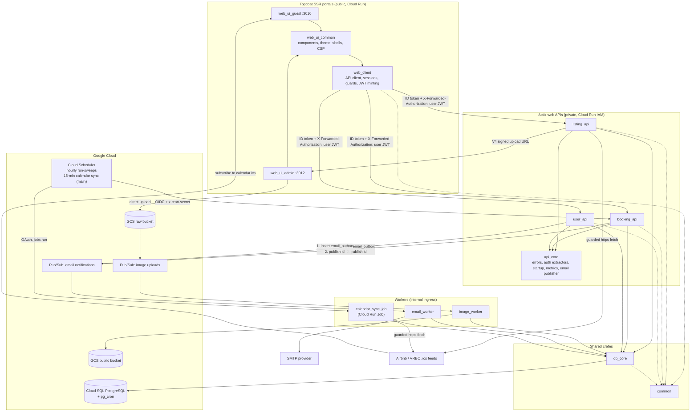
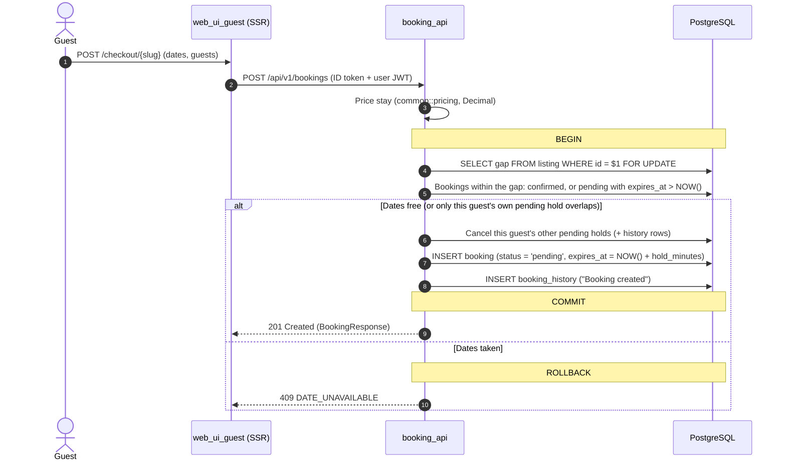
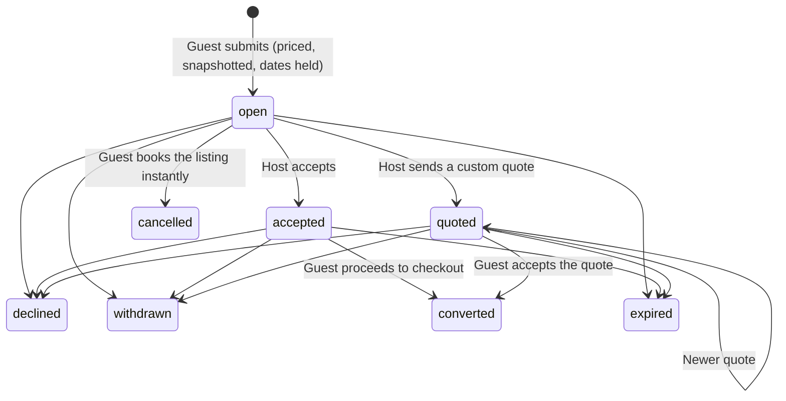
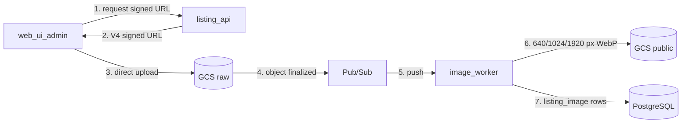
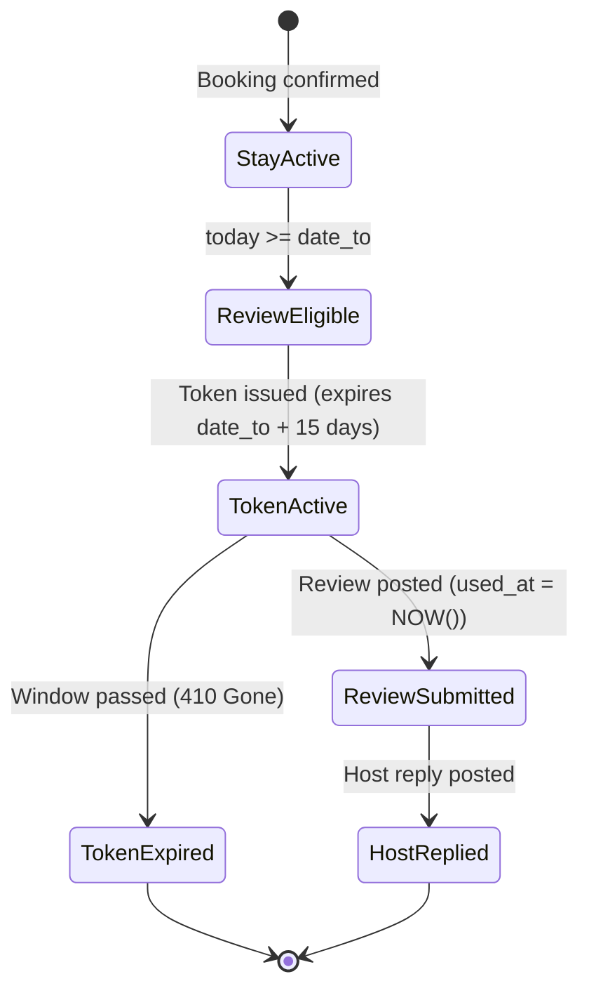

# Architecture — Our Places (`our_places_rs`)

Last updated: 2026-10-31

## 1. Summary & Architectural Goals

**Our Places** is a Rust monorepo for short-term rental of villas in Jamaica. Its parts are independent services, each deployed as its own scale-to-zero Cloud Run service, so each can scale and fail on its own.

### Key Architectural Drivers
- **Scale-to-zero on Cloud Run**: every service and worker idles at zero instances. Budget: cold start < 300 ms (p50) and < 1 s (p95) on 0.25 vCPU / 256 MB.
- **Server-rendered UI**: two Topcoat SSR portals (guest and admin) render HTML on the server and use HTMX for partial updates. No WASM is shipped to the browser.
- **Shared domain code**: DTOs, the pricing engine and reference data live once in `common` and are used by the APIs and the portals.
- **Financial precision**: all money, rates and taxes use `rust_decimal::Decimal`. `f32`/`f64` are banned in pricing paths.
- **No double bookings**: availability and holds are decided inside one PostgreSQL transaction holding a row lock on the listing (`SELECT ... FOR UPDATE`). No cache takes part.
- **Holds expire by timestamp**: a hold blocks dates only while `expires_at > NOW()`. Correctness never depends on a background job running.
- **One availability rule**: a booking blocks a stay when `date_from - gap < check_out` and `date_to + gap > check_in`, where `gap` is the listing's `days_between_bookings` limited to 0–365. Search, holds, booking updates, reservation changes and the calendar all apply it.

---

## 2. Component Architecture



Dependency rules:
- **APIs never depend on each other.** They share code only through `api_core`, `db_core` and `common`.
- **Portals never touch the database.** They reach data only through `web_client`, which calls the APIs over HTTP.
- **The APIs share one PostgreSQL database.** Each table is owned by the service that writes it. `db_core` is the only crate that runs SQL.

---

## 3. Crate Taxonomy

| Crate | Kind | Responsibility | Depends on |
| :--- | :--- | :--- | :--- |
| **`common/`** | lib | Domain DTOs, `rust_decimal` pricing and cancellation math, availability rules, tax documents, reference data (`reference.rs`), exchange-rate and GCS/geocode helpers, a typed HTTP client (`app_client/`, one module per API area) used by `web_client`. | — |
| **`db_core/`** | lib + bins | SQLx entities and compile-time checked queries, migrations (`db_core/migrations/`), seeds, connection pool. | `common` |
| **`app_api/api_core/`** | lib | Shared Actix pieces: `ApiError`, JWT extractors (HS256), server startup, `/actuator` health and Prometheus metrics, tracing, the email outbox publisher, settings loader. `calendar/`: the SSRF-guarded feed fetcher and the sync orchestration shared by listing_api and the calendar job. | `common`, `db_core` |
| **`app_api/listing_api/`** | bin | Listings, search, price overrides, Nominatim geocoding, V4 signed upload URLs, images. Server-side listing ownership checks (`authz`). Calendar sync routes: feeds, "Sync now", blocks, conflicts, overview and the `.ics` export. | `api_core`, `common`, `db_core` |
| **`app_api/calendar_sync_job/`** | bin | Cloud Run Job: syncs every due imported calendar, releases unstarted claims at its 9-minute deadline, republishes stuck calendar emails. | `api_core`, `common`, `db_core` |
| **`app_api/booking_api/`** | bin | Holds and bookings, availability, change requests, cancellation quotes, messaging, host ledger and payouts, tax documents, internal cron sweeps. | `api_core`, `common`, `db_core` |
| **`app_api/user_api/`** | bin | Registration, login, email verification, profiles, user slugs, admin user management. | `api_core`, `common`, `db_core` |
| **`app_api/image_worker/`** | bin | Pub/Sub push handler: resizes uploads into 640/1024/1920 px WebP and records them in `listing_image`. | `db_core`, `common` |
| **`app_api/email_worker/`** | bin | Pub/Sub push handler: loads an `email_outbox` row, renders its template, sends over SMTP (logs instead when no SMTP is configured). | `db_core`, `common` |
| **`web_client/`** | lib | UI-free API client, typed sessions, route guards, short-lived HS256 user JWTs. Adds the service account's Google ID token to every API call. | `common` |
| **`web_ui_common/`** | lib | Shared Topcoat components (DaisyUI v5 / Tailwind v4), theme tokens, guest and admin shells, security headers (CSP), asset bundler used by the Docker builds. | `web_client`, `common` |
| **`web_ui_guest/`** | bin | Guest portal: home, search, listing detail, checkout, bookings, change requests, messages, documents, reviews, profile. | `web_ui_common`, `web_client`, `common` |
| **`web_ui_admin/`** | bin | Admin and host portal: dashboard, listings and photos, pricing, bookings, users, payouts, promo codes, exchange rates. | `web_ui_common`, `web_client`, `common` |
| **`protoproj/`** | lib | gRPC/protobuf experiment (`tonic`). Not deployed; excluded from CI gates. | — |

### 3.1. Module layout of the largest modules

`booking_api/src/apis/` has one module per route group, and `routes.rs` wires them together:

| Module | Contents |
| :--- | :--- |
| `mod.rs` | Shared helpers: portal URLs, pricing-error mapping, confirmation codes, display currency, email enqueueing, booking authorization |
| `availability.rs` | Availability check, unavailable ranges |
| `bookings.rs` | Create a hold; read bookings |
| `stay_pricing.rs` | Prices a stay for quotes and holds; quote endpoints; refused-code logging |
| `promo_codes.rs` | Promo code management |
| `booking_updates.rs` | Status changes, delete, guest transfer |
| `reservation_changes.rs` | Change quotes and bilateral change requests |
| `messages.rs` | Booking messaging (the booking's guest × listing conversation) |
| `booking_requests.rs` | Requests to book: submit, read, accept, decline, withdraw, quote, checkout |
| `enquiries.rs` | Enquiries: send, read, close, quote |
| `conversations.rs` | Guest × listing conversations |
| `inbox.rs` | Host and admin inbox with response times |
| `request_notifications.rs` | Enquiry and request emails, expiry and reminder emails |
| `ledger.rs` | Host ledger, payout status, admin exchange rates |
| `documents.rs` | Cancellation quotes, tax documents |
| `notifications.rs` | Transactional email dispatch |
| `cron.rs` | `/api/v1/internal/cron/*` sweeps |
| `routes.rs` | Route table and OpenAPI document |
| `tests.rs` | Integration tests |

`db_core/src/booking/` re-exports everything from `mod.rs`, so callers keep using `db_core::booking::*`:

| Module | Contents |
| :--- | :--- |
| `hold.rs` | Create a hold, expire stale holds, transfer a hold to another guest |
| `queries.rs` | Read-only lookups |
| `update.rs` | Status transitions and host payout bookkeeping |
| `availability.rs` | Availability checks and unavailable ranges |
| `history.rs` | Immutable `booking_history` snapshots |

`db_core/src/booking_request/` holds enquiries and requests: `request` (submit), `respond` (accept, decline, withdraw), `quote`, `convert` (offer → hold), `supersede` (instant hold replaces the guest's request), `enquiry`, `expiry`, `inbox`, `notify` and the append-only `history`. `db_core/src/conversation.rs` holds the guest × listing threads.
| `*tests.rs` | Integration tests and shared fixtures |

The other large modules follow the same pattern: one file per area, re-exported from `mod.rs` so public paths are unchanged.

| Directory | Modules |
| :--- | :--- |
| `db_core/src/listing/` | `write` (create, update, delete), `queries` (search, by owner, by id or slug), `images`, `price_overrides`, `tests` |
| `user_api/src/apis/` | `registration` (sign-up, login, verification), `profile`, `admin`, `account` (password, email, deactivation), `sessions`, `tests`; `mod.rs` holds the DTOs and route table |
| `common/src/app_client/` | `listings`, `bookings`, `reservation_changes`, `payouts`, `reviews`, `users`; `mod.rs` holds the shared client and API URLs |

---

## 4. Key Subsystems

### 4.1. Booking Engine & Concurrency Control



- **One lock per listing**: two attempts to book the same listing run one after the other, while different listings are booked in parallel. The same lock protects availability checks for change requests (`reservation_change.rs`) and reviews.
- **Gap between bookings** (`listing.days_between_bookings`): the rule in §1 is one SQL condition, copied into each query because `sqlx::query!` needs literals. `availability_parity_tests` holds the copies to one answer. The value is limited to 0–365 on write and again in each query, so a stored value can't overflow a date or shrink the rule. Bookings already closer than a newly raised gap stay as they are, and are only rechecked if their dates change. Gap nights look the same as booked ones on the calendar.
- **Confirming a hold** checks expiry with `clock_timestamp()`, not `NOW()`, which is fixed when the transaction begins. A confirmation that waited on the listing lock can't succeed after its hold ran out and a rival took the dates.
- **Statuses** (`BookingStatus`): `pending` → `confirmed` → `completed`, or `cancelled` from `pending` or `confirmed`. Every transition writes a full row snapshot to `booking_history`. The whole guest journey, from enquiry and request to book through to completion or cancellation, is in [`booking-flow.mmd`](booking-flow.mmd).
- **Confirmation codes**: generated randomly. If a code collides with an existing one, booking_api retries up to `application.max_attempts` times.
- **Inactive listings** (`listing.is_active = false`): `GET /api/v1/listings` leaves them out unless `include_inactive=true`, which only the admin portal and the My Bookings name lookup send. The guest portal returns 404 for their listing and checkout pages. New quotes and holds get 409 `LISTING_UNAVAILABLE`; the hold re-reads the flag under the listing lock. Existing bookings are unaffected.

#### Booking Modes, Enquiries and Requests to Book (#105)

Each listing sells `instant`, `request` or `both` (`listing.booking_mode`, default `instant`). A hold on a request-only listing, or a request on an instant-only one, is a 409 `BOOKING_MODE_NOT_ALLOWED`.



- **Enquiries** are questions with dates and a guest count. They start the guest × listing `conversation` and never hold dates. A host can quote straight on one, which turns it into a quoted request under the listing lock.
- **Live requests block like live holds.** `open`, `accepted` and `quoted` requests with `expires_at > NOW()` block every availability path (check, calendar, search, holds, reservation changes), widened by the same gap. `availability_parity_tests` covers nine request states.
- **Windows.** A request waits `application.request_response_hours` (24) for the host; an accepted request or quote is held `application.quote_valid_hours` (48). Both are capped at check-in day 00:00 in Jamaica; a request whose capped window is under an hour is refused with `REQUEST_WINDOW_TOO_SHORT`.
- **One live request per guest and listing** (partial unique index). The guest's own lapsed request is expired inline first. An instant hold by the same guest cancels their live request on that listing and closes their open enquiry there.
- **Price integrity.** The request stores a `StayPriceSnapshot`; a custom quote stores its own (the host's stay price in base currency, at the request's frozen rate, with fees, GCT and platform fee recalculated and any promo dropped). Conversion copies the snapshot into a `pending` hold with `pending_hold_minutes`, and the request becomes `converted`, in one transaction under listing → request → currency → guest bookings → promo locks, so the dates are never free or double-held in between. A quoted request converts only with the quote id the guest saw (`QUOTE_SUPERSEDED` otherwise).
- **Host earnings estimate.** `GET /api/v1/enquiries/{id}` gives the host and admins (never the guest) `host_estimate`: the enquiry's stay priced by `price_stay` in the listing's base currency (rate 1, no promo or quote), then `host_gross` and `calculate_host_payout` at the listing's `commission_pct`, which is the payout ledger's formula. A stay that can't be priced gives `null` with a `warn!`; the enquiry still loads.
- **Unread count.** The admin portal's left-panel link reads "Inbox (n)" with the unread guest-sent messages across the user's listings (all listings for admins), from `GET /api/v1/conversations/unread-count`: one `COUNT` on the partial unread index. It covers enquiry, request and booking threads (one conversation per guest × listing) and clears as threads are marked read. A failed fetch shows plain "Inbox" and logs a `warn!`; the page still renders.
- **Audit and housekeeping.** Every enquiry and request change is appended to `booking_request_history` with the actor. `run_sweeps` expires lapsed requests and closes enquiries on check-in day, emailing both parties once (`request_notification_log`); the notification sweep reminds the host once in the last `request_near_expiry_pct` (25%) of a response window.

#### Pending Hold Lifecycle
1. **Window is configuration, not code.** The hold length is `application.pending_hold_minutes`: 120 by default, set in `app_api/booking_api/config/Default.toml`. Override it per deploy, with no rebuild, via the env var `EA__APPLICATION__PENDING_HOLD_MINUTES`. booking_api refuses to start if the value is not positive. `create_booking` stores `expires_at` once, at insert time.
2. **Expiry is enforced on every read.** Availability queries treat a `pending` row as blocking only while `expires_at > NOW()`. An expired hold frees its dates immediately, even before any cleanup runs.
3. **Housekeeping.** Expired holds are flipped to `cancelled` with a history snapshot in two places:
   - the `pg_cron` job `cleanup_stale_pending_holds`, which runs every 15 minutes;
   - booking_api's `POST /api/v1/internal/cron/run-sweeps`, which Cloud Scheduler calls hourly at :05.

   Both use `FOR UPDATE SKIP LOCKED`, so they never fight over the same rows.
4. **Reminder.** The same sweep emails the guest once (deduplicated via `booking_notification_log`) when a hold is 15–45 minutes from `expires_at`.

### 4.2. Tri-Currency Pricing

```
Base currency (listing price) --exchange rate--> Payment currency (guest) --GCT--> Totals
```

1. **Base nightly rate**: comes from `listing.price_per_night`, or a matching `listing_price_overrides` row. Overlapping override date ranges are rejected by a GiST `EXCLUDE` constraint.
2. **Price the stay**: `BookingCalculator` builds the total in typed steps: seasonal nights plus extra-guest fees → weekly/monthly discount → cleaning fee and deposit → promo code → tax → platform fee → total. The type-state makes the promo step impossible to skip. Tax is charged on the stay and cleaning fee after the promo. The guest platform fee is 5% of the stay after the promo. Neither the platform fee, the refundable deposit nor GCT is discounted. Quotes and holds share `stay_pricing::price_stay`, so they can't disagree, and the listing page and checkout show its total. Its promo-free steps are `common::pricing::price_before_promo`, which listing search also uses for card totals, and `common/testdata/stay_pricing_golden.json` holds both services to the same figures. Dates in the past (by the Jamaica date) and stays over `application.max_stay_nights` are refused with a 400 `INVALID_STAY_DATES`, and stays too large for the booking's money columns with a 400.
3. **Convert currency**: the result is converted with `db_core::exchange_rate::get_rate`, the single, effective-dated lookup: the latest explicit `base → target` row with `effective_at <= at`, otherwise the latest `target → base` row inverted to 6 dp (banker's rounding, in Rust). There is never a fallback rate or currency: a missing pair is `422 FX_RATE_UNAVAILABLE`. Every caller states a `RateUse`:
   - `NewQuote` (listing search and detail, checkout hold): retired pairs are ignored (also as a derived source) and both currencies must be active.
   - `Settlement` (payout at confirmation, reservation-change payout, tax-document JMD rate, booking display): history is honoured even after retirement or deactivation.

   Listing search converts in one batched query; a listing that cannot be quoted keeps its base label, has no price and carries `price_unavailable_in` (cards show "Price unavailable in CUR").

   **Search by dates and guests** (`GET /api/v1/listings`): `q` matches name, city or country, and `check_in`, `check_out` and `guests` filter inside the search query, so pages count only matching listings. A dated search returns only active, priced listings that are free under the rule in §1 and meet the minimum stay, including overrides covering a night of it. Each listing then carries a `stay_total`, priced on a blocking thread from one batched rate lookup and one batched override load. A listing that can't be priced stays in the results with no total. Invalid input is a 400 with `INVALID_STAY_DATES`, `INVALID_GUESTS` or `INVALID_SEARCH_TEXT` before any query runs, and search text stays out of logs: every API's root span records `http.target` as the path alone.
4. **Rate locking**:

   | Conversion | Rate used |
   |---|---|
   | Listing base → payment (`booking.exchange_rate`) | effective at hold creation; reused for the booking's whole life |
   | Booking currency → host currency (payout ledger) | effective at confirmation; the ledger row keeps its currency, rate and commission through revisions, change approvals and cancellation |
   | Promo code currency → payment (`booking.promo_terms`) | effective at hold creation; reused for the booking's whole life |
   | Booking currency → JMD (tax documents) | effective at the document's issue date |
5. **Currencies and rates are data**: `currencies` is the reference table every currency column references (`ON DELETE/UPDATE RESTRICT`); currencies are deactivated, never deleted, and no currency list is hardcoded in code. Admins manage currencies and rates on `/admin/exchange-rates`: rates are append-only versions (no backdating beyond `rate_effective_grace_seconds`, at most 366 days ahead, a 5% change needs confirmation), only scheduled versions can be deleted, and pairs are retired rather than removed. Deactivating a currency or retiring a pair is refused while live listings depend on it. Every change is written to the append-only `currency_audit_log`. Rate transactions lock currency rows in ascending code order, then a per-pair advisory lock (`hashtext('fx:'||base||':'||target)`), then read the clock.
6. **Statutory tax**: rates (Jamaican GCT 15%) are fixed in `common/src/reference.rs`. Exchange rates live in the database.
7. **Tax documents**: completed stays get statutory tax documents (`tax_document`), issued by the Merchant of Record named in `TAJ_SUPPLIER_*`.

### 4.2.1. Host Payout

There is one formula, `common::pricing::host_gross`. The host funds every promo discount:

```
gross      = round((accommodation net of discounts + cleaning fee net of promo) × host rate)
commission = round(gross × commission_pct)
net        = max(0, gross − commission)
```

On a cancellation the cleaning fee is refunded in full, so a retained payout is accommodation only. It returns the booking's ledger row to `pending`. A payout already `processing`, `paid` or `refunded` isn't changed, and a warning is logged.

### 4.2.2. Promo Codes

Admins manage every code and hosts their own, on `/admin/promo-codes`. Terms never change after creation, and codes are deactivated, never deleted. A host-owned code only applies to that host's current listings.

- **Usage is derived, not counted.** A use counts while its redemption isn't released and its booking is `confirmed`, `completed`, or `pending` with `expires_at` in the future. A live `open` or `accepted` request carrying the code also counts (#105), so the offer can always convert at the accepted price; a custom quote drops the code and frees the use. So expiry sweeps and cancellations free a use with no bookkeeping.
- **Locks**: a hold takes listing → currency → the guest's other pending bookings → promo code. Confirming a promo booking takes listing → booking → promo code, then re-reads the time, so a hold that lost its use at expiry can't be confirmed. The count is a separate statement after the lock, which gives it a fresh snapshot.
- **Bookings keep a snapshot** in `promo_terms`, so later changes can't reprice them. A reservation change re-checks only the stay rules against that snapshot: minimum nights, stay window and minimum value. If they fail, the discount is removed and the use is freed, and the guest is told before accepting.
- **Logs**: code strings never enter a log or span. Refused attempts log the guest, the reason and a SHA-256 hash. Attempts aren't rate-limited yet (#110).

### 4.3. Image Pipeline



Image bytes never pass through an API. The portals render `<picture>`/`srcset` from the `listing_image` rows.

### 4.4. Transactional Email (Outbox)

1. **Write the outbox row.** booking_api or user_api inserts an `email_outbox` row (recipient, template, JSON payload, `max_attempts`).
2. **Publish the id.** The API publishes that row's id to the email Pub/Sub topic (`api_core::email_publisher`) from a detached task, so a slow publish never slows the request.
3. **Send.** email_worker receives the push, claims the row with `FOR UPDATE SKIP LOCKED`, renders the template from `app_api/email_worker/templates/`, and sends it over SMTP. Delivery status is recorded on the row.
4. **Deduplicate scheduled emails.** Scheduled notifications (48-hour pre-arrival, hold expiry reminder) are claimed in `booking_notification_log` first, so a re-run of a sweep never sends duplicates.

### 4.4.1. iCal Calendar Sync (#58)

Hosts import Airbnb/VRBO `.ics` feeds; their events become **blocked dates**. Hosts also block nights by hand. Every listing exports one public busy-only feed from the guest portal (`/listings/{id}/calendar.ics`), so Our Places is the hub. Spec: [`spec-58`](specs/spec-58-ical-calendar-synchronization-external-channel-manager.md).

- **Availability**: `listing_blocked_dates` is checked by all seven paths (check, check-excluding, calendar, hold, request create/quote/convert, accept, search). Imported blocks are widened by the turnover gap; manual ones aren't. A changed booking is only checked on nights it doesn't already hold, so a conflicted stay can be shortened. `availability_parity_tests` keeps the copies in step.
- **Claim → fetch → reconcile**: a run claims feeds atomically (`FOR UPDATE SKIP LOCKED`, stamping `last_attempt_at`), fetches with no transaction open, then reconciles one transaction per feed: `lock_timeout 5s`, locks **listing → feed**, checks `sync_generation` (a URL change, delete or disable mid-fetch makes the result stale), upserts events with `UNNEST`, deletes the ones gone, detects conflicts, updates the feed. A lock timeout is `deferred`, not a failure. Feeds of one listing reconcile one at a time (one pool connection); listings run in parallel.
- **Failures** lock the feed only and never touch blocks. Four scheduled failures in a row email the host once; a success re-arms it.
- **Conflicts**: an imported block reaching a confirmed stay or live hold is upserted on `(feed_id, external_uid, booking_id)`; it reopens (with one email) when it was stale and is live again or got worse. Staleness and the current kind are worked out on read. Bookings are never changed automatically.
- **SSRF guard** (`api_core::calendar::fetch`): https only; IP literals checked against the blocklist (hyper skips the resolver for them); hostnames filtered at connect time by a custom resolver (closes DNS rebinding); every redirect re-checked, at most 3; no proxy; 2 MB / 10 s caps; metadata IPs always blocked. Feed URLs are secrets: `.without_url()` on every reqwest error, redacted `Debug`, host-only spans. Local-only toggles (`EA__CALENDAR_SYNC__*`) come from env only and are refused on Cloud Run.
- **Triggers**: "Sync now" runs inline in listing_api (60 s rate limit per listing, 20 s deadline); the scheduled `calendar_sync_job` runs every 15 minutes on `main`.

### 4.5. Verified Reviews



- **Single use**: a token is consumed atomically with `UPDATE review_token SET used_at = NOW() WHERE token = $1 AND used_at IS NULL ... RETURNING`.
- **Rating updates are serialized**: posting a review locks the listing row while it recalculates `overall_rating` and `review_count`.

---

### 4.6. Distributed Tracing

One trace follows a request from the browser through the portal, the APIs and the workers (`common::telemetry`, OpenTelemetry):

- **HTTP:** the portals (`web_ui_common::request_tracing::RequestTracing`) and APIs (`api_core::tracing_utils::CustomRootSpanBuilder`) continue an incoming `traceparent` or Cloud Run's `X-Cloud-Trace-Context`; `AuthenticatedClient` forwards both on every API call.
- **Async hops:** email events carry the trace context as Pub/Sub attributes. Image uploads carry it as `x-goog-meta-traceparent` object metadata, required by the signed URL and delivered in the GCS notification.
- **Logs:** each Cloud Logging entry gets `logging.googleapis.com/trace` and `spanId`, so one filter shows every service's logs for a request.
- **Export:** with `TRACE_EXPORTER=gcp`, spans go to Cloud Trace over OTLP (`telemetry.googleapis.com`), sampled by `TRACE_SAMPLE_RATIO`. Configuration and IAM are in [ENVIRONMENT.md §4](ENVIRONMENT.md).

## 5. Security

- **User auth**: the portals mint short-lived HS256 JWTs (`web_client::jwt`) after login, and `api_core::auth` verifies them. Both sides share `JWT_SECRET`.
- **Service auth**: the APIs deploy with `--no-allow-unauthenticated`. The portals call them with their service account's Google ID token and pass the user's JWT in `X-Forwarded-Authorization`.
- **Listing writes**: every `listing_api` write checks the JWT (401), the listing (404) and ownership or the admin role (403) on the server (`listing_api::authz`); the portals pass the user's JWT.
- **Calendar feeds**: see §4.4.1 for the SSRF guard. The export feed is public by design (busy dates and reservation numbers only, no guest details).
- **Cron auth**: Cloud Scheduler calls booking_api's `/api/v1/internal/cron/*` with an OIDC token *and* the `x-cron-secret` header. The secret is compared in constant time.
- **Passwords**: hashed with `bcrypt` at `DEFAULT_COST`, inside `spawn_blocking`.
- **Portals**: strict security headers and CSP (`web_ui_common::security_headers`). No inline JS.
- **SQL**: queries are checked at compile time (`sqlx::query!`, with offline metadata in `.sqlx/`). Applied migrations are immutable.

---

## 6. Configuration

Each API loads `config/Default.toml`, then `config/{RUN_ENV}.toml`, then any `EA__SECTION__KEY` environment variables (`api_core::settings::get_settings`). Settings that matter operationally:

| Setting | Default | Override |
| :--- | :--- | :--- |
| `application.pending_hold_minutes` | 120 | `EA__APPLICATION__PENDING_HOLD_MINUTES` |
| `application.max_attempts` | 5 | `EA__APPLICATION__MAX_ATTEMPTS` |
| `application.max_stay_nights` | 3650 | `EA__APPLICATION__MAX_STAY_NIGHTS` |
| `application.request_response_hours` | 24 | `EA__APPLICATION__REQUEST_RESPONSE_HOURS` |
| `application.quote_valid_hours` | 48 | `EA__APPLICATION__QUOTE_VALID_HOURS` |
| `application.request_near_expiry_pct` | 25 | `EA__APPLICATION__REQUEST_NEAR_EXPIRY_PCT` |
| `feature_flags.enable_hard_deletes` | false | `EA__FEATURE_FLAGS__ENABLE_HARD_DELETES` |

Secrets and per-environment variables are listed in [ENVIRONMENT.md](ENVIRONMENT.md).

---

## 7. Build, Deploy & Scaling

- **Images**: one Dockerfile per service (`Dockerfile.<service>`). Each builds with `cargo-chef` for dependency caching and `SQLX_OFFLINE=true`, and runs as a non-root user on `debian:bookworm-slim`.
- **Release profile**: tuned for request speed and startup rather than size: `opt-level = 3`, fat LTO, one codegen unit, stripped symbols.
- **Deploy**: [`cicd_full_stack.yml`](../.github/workflows/cicd_full_stack.yml) builds and deploys every service with `gcloud run deploy`. It also creates the Pub/Sub topics and subscriptions, the IAM bindings and the Cloud Scheduler job. Branch `main` deploys to prod; other branches get suffixed dev services.
- **Scaling**: every service runs with `--min-instances=0`. Each is capped at `--max-instances=4`. The services are stateless (sessions are in PostgreSQL, holds are row-locked), so the cap is a deploy flag, not a code change. The limit after that is database connections: each instance's pool is capped at 5 (`db_core::connection`), so the five database-backed services (3 APIs, 2 workers) can open up to 5 × 4 × 5 = 100 connections at full scale. The Cloud SQL tier's `max_connections` must stay above that.
- **Calendar sync job**: `calendar-sync-<branch>` is a Cloud Run Job deployed on every branch with the dedicated `SA_CALENDAR_JOB` account (Cloud SQL client, Pub/Sub publisher on the email topic, `run.invoker` on its own job). Only `main` has a Cloud Scheduler trigger (every 15 minutes); elsewhere run `gcloud run jobs execute calendar-sync-<branch> --wait` or use "Sync now". Scheduler jobs total 3: sweeps on dev and main, plus calendar sync on main.
- **Known limit (calendar sync)**: a run claims pages of 32 and stops starting feeds at 9 minutes. At MVP scale (≤ 25 feeds) a run takes seconds; at 1000× (25k feeds) 8 workers with ~1 s fetches cover about 4k feeds per run, so the refresh interval grows to ~90 minutes and the "4 failures" alert to ~6 hours. Raise `EA__CALENDAR_SYNC__JOB_CONCURRENCY` first; per-listing fan-out is the follow-up. Watch `emails_republished` in the run summary: a steady non-zero value means post-commit publishes are failing.
- **Terraform**: `infra/` holds network, Cloud SQL, accounts and a placeholder Cloud Run module. The workflow, not Terraform, is the source of truth for Cloud Run services today.

---

## 8. Local Development

```bash
docker compose up -d            # PostgreSQL with pg_cron
sqlx migrate run --source db_core/migrations
cargo build --workspace
cargo test --workspace --exclude protoproj
SQLX_OFFLINE=true cargo clippy --workspace --exclude protoproj --all-features -- -D warnings
cargo sqlx prepare --workspace  # after changing any query
```

The quality gates every change must pass are in [CONSTRAINTS.md](../CONSTRAINTS.md).
